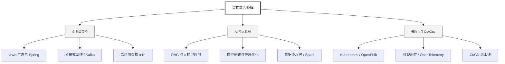

  <h1>你好，我是 Ellen Liu 👋</h1>
  

    <a href="README.md">English</a> | 
    <b>简体中文</b>
  

## 🧠 技术栈与核心能力

智能化企业系统建设路线图，涵盖全栈人工智能工程、云基础设施架构及模型部署等核心技术领域。

## 🚀 Highlighted 工作

- **开源 AI 项目**: [基于 BERT 的声明检测模型](https://huggingface.co/XiaojingEllen/bert-finetuned-claim-detection) (Apache-2.0)
  - *已被哥伦比亚大学 (UBC) 研究项目引用。*
  - *手写 Transformer 核心代码，以验证理论与工程的一致性。*
- **金融基础设施**: 从 0 到 1 构建数字银行支付中间件及智能保险理赔系统。

## 📑 每日论文速递 (ArXiv)
<!-- DAILY_ARXIV_SUMMARY_START -->
**更新日期: 2026-11-20**

### 1. [AgentRoboCritic：理解前沿智能体在直接机器人控制中的能力](http://arxiv.org/abs/2611.26613v1)
- **摘要**: 前沿多模态语言智能体（如 GPT-6 Astra）已展现出通过低层数值动作直接控制机器人的强大能力，而无需依赖高层原语。然而，现有基准仅报告回合级成功率，既无法揭示这些智能体如何成功，也无法说明它们在何处失败。本文针对 12 个操作基准，对前沿智能体在直接机器人控制中的表现进行了系统的动作级分析。我们提出 AgentRoboCritic，一种基于意图的评判框架：策略智能体在每次动作的同时声明局部意图，评判器则针对该意图评估动作的结果与失败模式。我们的动作级分析表明，前沿智能体在直接机器人控制中具有值得期待的能力，包括对局部执行失败的闭环恢复、跨多样场景的可靠语义 grounding，以及无需任务特定适配的强零样本操作能力。分析同时揭示了其当前局限，包括与任务相关的物理执行瓶颈（如抓取与对齐），以及不同失败模式下恢复能力的不均衡。最后，我们在一个包含 400 个动作的人工标注基准上验证了评判器，并发布了包含 12,844 个标注动作的数据集以及一个微调的开源评判器 Muse-Glimmer-30B，其失败模式准确率从 32.58% 提升至 74.24%，从而支持低成本的动作级分析。

### 2. [AutoMaster：通过让同一模型成为更好的教师来实现自主后训练](http://arxiv.org/abs/2611.26510v1)
- **摘要**: 任务成功本身并不能说明后训练应当强化哪些行为。即便是成功的教师轨迹，也可能包含缺乏依据的假设、无效的重复或流于表面的验证。我们提出 Skill-FT（技能引导微调），它利用自然语言技能来抑制不良习惯，并在教师 rollout 过程中激发出代表性不足的有效行为，然后在由此产生的轨迹上微调目标模型。我们引入 AutoMaster，这是一个自主后训练系统，其中 LLM 智能体通过轨迹分析、技能设计、数据选择以及来自 rollout 和目标模型评估的反馈来开发这些干预措施。在 Terminal、Search 和软件工程任务中，使用 4B 和 9B 目标模型，AutoMaster 在成功的无引导教师轨迹上相比 Vanilla SFT 将平均性能提升了 1.42–8.99 个百分点，同时教师、任务池、训练集规模和 SFT 配方保持不变。结合消融实验和轨迹分析，这些结果表明行为塑造可以使固定模型成为更有效的教师。我们进一步发现，在所有六种设置中，在 SFT 期间保留技能指令比移除它们产生更高的平均性能，尽管它们在评估时并不存在且监督输出完全相同。这些发现表明，将技能上下文保留为训练演示的一部分可以支持更好的行为内化。

### 3. [MemFolder：结构引导的记忆折叠，用于高效的智能体记忆管理](http://arxiv.org/abs/2611.26427v1)
- **摘要**: 长期智能体在交互过程中会积累大量外部记忆存储，从而增加存储、检索和响应生成的成本。效率受到两个耦合因素的制约：记录数量不断增长会增加检索开销，而检索到的上下文变长会增加预填充计算和解码阶段的注意力成本。现有方法会对记录进行剪枝或合并，但剪枝可能丢弃有用的证据，而合并可能产生数量更少但更长的检索单元。我们提出 MemFolder，一个结构引导的记忆折叠框架，能够依次减少记录数量和上下文长度。该框架包含两个共享记忆组的核心组件，利用跨记录结构来引导证据合并和紧凑表示。RecordFolder 对实体提及进行锚定，逐步选择具有代表性且互补的锚点，并将语义亲和度与实体亲和度同时间链相结合，把兼容的记录合并为更少的检索单元。ContextFolder 将这些组内的原始记录编码为紧凑文本，并在关键事实无法恢复时利用验证反馈修正编码。在三个基于文本的记忆基准 LoCoMo、PersonaMem 和 LongMemEval 以及两个多模态基准 M3-Bench-web 和 M3-Bench-robot 上的实验证明了我们方法的强劲性能。值得注意的是，在 Mem0 上，RecordFolder 在三个基于文本的基准上以少 50% 的记录保留了原始平均性能的 99.0%，在性能保留率上比最强基线高出 1.9 个百分点。结合 ContextFolder 后，现有记录压缩方法进一步缩短了其输出记录，同时保留了大部分性能。

<!-- DAILY_ARXIV_SUMMARY_END -->

## 🌐 保持联系

  
<i>期待与您探讨 AI 基础设施的未来！</i>

