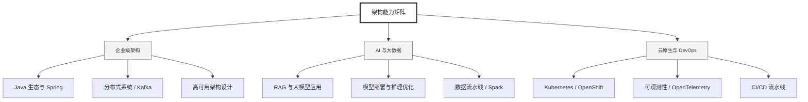

  <h1>你好，我是 Ellen Liu 👋</h1>
  

    <a href="README.md">English</a> | 
    <b>简体中文</b>
  

## 🧠 技术栈与核心能力

智能化企业系统建设路线图，涵盖全栈人工智能工程、云基础设施架构及模型部署等核心技术领域。

## 🚀 Highlighted 工作

- **开源 AI 项目**: [基于 BERT 的声明检测模型](https://huggingface.co/XiaojingEllen/bert-finetuned-claim-detection) (Apache-2.0)
  - *已被哥伦比亚大学 (UBC) 研究项目引用。*
  - *手写 Transformer 核心代码，以验证理论与工程的一致性。*
- **金融基础设施**: 从 0 到 1 构建数字银行支付中间件及智能保险理赔系统。

## 📑 每日论文速递 (ArXiv)
<!-- DAILY_ARXIV_SUMMARY_START -->
**更新日期: 2026-11-25**

### 1. [DiaCap：联合学习视听对话字幕中谁在何时发言](http://arxiv.org/abs/2611.33153v1)
- **摘要**: 我们提出DiaCap，一种用于全面对话字幕生成的音视频大语言模型，可为视频中的每句话生成转写文本、时间戳以及说话人的视觉描述。考虑到话语时间与音视频说话人分离紧密耦合，DiaCap将这两项任务统一在单一模型中，并分两个互补阶段进行训练。首先，我们在22.5万条精选片段上训练DiaCap，使用对每句话进行详细密集标注的合成字幕。其次，我们通过强化学习在2900条经人工校正的片段上进一步优化模型，使用细粒度反馈直接评估话语时间、说话人分组和说话人绑定。在DiaDemBench上（我们为其扩展了话语级时间戳和字幕隐去），使用现成转写文本的DiaCap及其端到端变体DiaCap-E2E均取得了强劲结果。具体而言，DiaCap在音视频说话人分离上的表现与Gemini 4 Argon相当，而在时间戳准确性上明显优于后者（76.59对42.76 TIME）。它还在多语言和长达数分钟的视频上保持了强劲的说话人分离性能，并可迁移至音视频问答任务。

### 2. [CoT-Proxy：用于蒸馏长时程策略的跨格式迁移](http://arxiv.org/abs/2611.33148v1)
- **摘要**: 推理模型通过强化学习，或以更低成本的方式——在更强教师的轨迹上进行微调，从而成为长时程智能体；这些轨迹既包含教师的思维链，也包含其动作。标准的微调方法会同时模仿两者，然而最强的教师是闭源模型，其思维链隐藏在 API 之后。我们表明，思维链完全可以被省略，并且长时程策略可以仅从教师的动作中蒸馏得到。学生在这些轨迹上训练，其推理块保持为空，同时对其自身生成的回放缓冲区施加 KL 损失，以限制其偏离初始模型。令人惊讶的是，从这些推理块为空的轨迹中学到的策略，能够迁移到启用思考的推理阶段：此时学生以自己的风格进行推理，同时像教师一样行动，我们将这一效应称为跨格式迁移。蒸馏 Qwen3.6-27B 的动作，使 Qwen3-4B 在 AppWorld 上的任务成功率从 7% 提升到 18%，使 Qwen3-32B 从 12% 提升到 25%。我们进一步引入 CoT 代理（CoT-proxies），即置于空推理块之后的教师推理简短摘要，它将 Qwen3-4B 进一步提升到 35%。由于动作和 CoT 代理都不需要隐藏的思维链，该配方可原封不动地应用于闭源教师。从 GPT-5.6 Luna 的可见输出及其 API 返回的推理摘要中进行蒸馏，使 Qwen3-4B 在 AppWorld 上从 7% 提升到 48%，在 SWE-bench Verified 上从 3% 提升到 28%。

### 3. [SAG-Mem-1.0 技术报告](http://arxiv.org/abs/2611.33124v1)
- **摘要**: 长期对话记忆需要检索分散在多个对话会话中的互补事实，包括与原始问题相似度有限的中间证据。现有方法通常依赖派生记忆表示或持久化关系结构，这会引入构建成本，并可能丢失源细节。我们提出 SAG-Mem，一种对话记忆框架，它将完整对话消息保留在互不重叠的块中，并通过查询时词法扩展发现互补证据。记忆构建无需模型推理，使用词法索引，不进行基于 LLM 的抽取、摘要或语义关系构建。在查询时，BM25 检索初始候选，证据评估器识别有用块，来自所选证据的词法线索指导额外的检索轮次。检索到的对话进一步标注受支持的相对时间表达的日历解释，同时保留原始措辞和时间粒度。我们还引入 SAG-Mem-Lite，这是一种替代配置，用基于嵌入的候选评分替代证据评分，在两个基准上以低查询延迟实现比 Full Context 和所有基于记忆的基线更低的操作成本。在 LoCoMo 和 LongMemEval 上，SAG-Mem 分别取得 83.08 和 80.20 的总分，在两个基准上均为所评估方法中最高。在 LongMemEval 上，它比最强的对比基线高出 7.20 分。SAG-Mem-Lite 分别取得 77.09 和 77.20 的分数。这些结果支持将对话保留和证据引导的检索扩展作为长期对话记忆的有效设计。

<!-- DAILY_ARXIV_SUMMARY_END -->

## 🌐 保持联系

  
<i>期待与您探讨 AI 基础设施的未来！</i>

