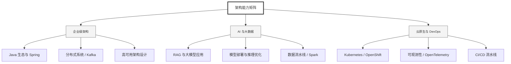

  <h1>你好，我是 Ellen Liu 👋</h1>
  

    <a href="README.md">English</a> | 
    <b>简体中文</b>
  

## 🧠 技术栈与核心能力

智能化企业系统建设路线图，涵盖全栈人工智能工程、云基础设施架构及模型部署等核心技术领域。

## 🚀 Highlighted 工作

- **开源 AI 项目**: [基于 BERT 的声明检测模型](https://huggingface.co/XiaojingEllen/bert-finetuned-claim-detection) (Apache-2.0)
  - *已被哥伦比亚大学 (UBC) 研究项目引用。*
  - *手写 Transformer 核心代码，以验证理论与工程的一致性。*
- **金融基础设施**: 从 0 到 1 构建数字银行支付中间件及智能保险理赔系统。

## 📑 每日论文速递 (ArXiv)
<!-- DAILY_ARXIV_SUMMARY_START -->
**更新日期: 2026-10-25**

### 1. [基于LLM的IT工单分类中的成本感知弃权机制](http://arxiv.org/abs/2610.31657v1)
- **摘要**: IT支持工单的错误自动路由可能比人工分诊代价更高。我们将成本感知弃权评估为一种离线、成本条件化的就绪度评估：在显式成本下于校准数据上选择路由策略，然后在留出测试数据上对该冻结策略进行一次评估。在一个公开的47,837张工单、八类语料库上，我们在零样本和少样本提示下比较了四个训练的非LLM分类器与四个大语言模型。在示例性成本模型(c_ok, c_triage, c_wrong) = (0, 1, 5)下，TF-IDF结合逻辑回归以及在校准集上选择的0.60阈值将测试成本从0.763降至0.472，相对降低38.1%（配对比率自助法95% CI [35.7%, 40.4%]），同时将错误路由从15.3%降至3.5%。在事后成本参数分析中，冻结的校准选择策略在16种设置中的14种里于留出测试数据上也优于始终路由和始终延迟两种策略。最强的提示配置在分层1,000张工单测试子集上达到0.477准确率，而同一批工单上微调DistilBERT为0.879。等渗校准降低了期望校准误差，但未能可靠改善区分度：GPT-4o-mini少样本在校准前后只有一个置信度值，正确性AUROC为0.500。因此，我们同时报告正确性AUROC和并列感知的风险-覆盖率面积以及ECE。在解析推导的盈亏平衡概率0.80处，七种提示配置延迟所有工单；Haiku少样本仅路由19/1,000。仅LLM一致性控制和边际/熵拒绝基线进一步将校准与区分度分离。研究结果仅限于该数据集、提示设计、模型端点和示例性成本；本工作是一个评估框架，而非新的弃权算法或通用部署认证。

### 2. [智能体能否调试网络语料库？对斯洛伐克语FineWeb2的智能体审计](http://arxiv.org/abs/2610.31636v1)
- **摘要**: 像FineWeb2这样的多语言流水线将同一套处理方案应用于上千种语言，导致各语言特有的失效模式无法被预先识别。我们将LLM仅使用一次，将其作为语料库调试器而非分类器：一个可调用工具的智能体通过只读、有预算限制的API探索语料库，并将每项发现编译为可执行测试，再由母语者进行验证。在FineWeb2的2650万篇文档的斯洛伐克语部分上，三次运行每次花费2.21–2.84美元，共发现涵盖四类现象的七项发现。其中最大的一项是一个由1,408,437篇文档（5.32%）组成的机器生成内容农场，它通过了流水线的过滤器，其中86.6%甚至通过了更严格的阈值。盲法标注支持7项发现中的6项（缺陷率为.53–1.00，而随机对照为.08），有一项未获支持。编译后的测试套件在无GPU的情况下以0.7秒的挂钟时间扫描整个语料库，而每次LLM分类遍历则需花费1.2万–9万美元。最佳静态采样基线比任何智能体运行验证了更多的选择器，且成本不到其一半。该智能体贡献了精确的流行率、经抽样文档核验的精确率估计、对流水线为何遗漏每个切片的解释，以及一个可复用的测试。我们发布了该框架、斯洛伐克语测试套件、验证数据和智能体轨迹。

### 3. [真实标注如何塑造检索分数：乳腺病变检索增强生成系统的证据感知评估](http://arxiv.org/abs/2610.31606v1)
- **摘要**: 目的：描述一种针对乳腺病变管理文献的临床检索增强生成（RAG）系统的证据感知检索评估方案，解决检索分数对标注覆盖度的依赖问题。方法：使用包含18篇文档的语料库和包含18个查询的开发基准，每篇文档对应一个是/否问题或WH问题。检索结合了稠密嵌入、BM25和交叉编码器重排序。评估了128至1024个token的块大小、0至20%的重叠率以及四种检索器配置。相关性由映射到所有包含该证据的块的证据片段定义，将具有等效证据的重叠块视为相关。检索使用R-Precision、Recall@K、MRR和nDCG@K进行评估。另外，在512个token的索引上以K=1至5使用DeepEval声明级指标评估生成，以deepseek-v4-pro作为LLM评判器，并使用BLEU/ROUGE指标。结果：所选的混合检索器使用384个token的块和20%的重叠率，在18个查询中的17个的前三个结果中检索到了被接受的证据。Recall@3、R-Precision、MRR@3和nDCG@3均达到0.94。真实标注整理将证据片段从25个增加到37个，将被接受的块目标从36个增加到51个，而未改变检索排名。结论：交叉编码器重排序取得了最高的检索分数。扩展的相关性标注增加了被识别的证据而未改变排名，凸显了标注敏感性。小型开发集和检索信息驱动的标注整理需要独立验证，包括放射科医生对证据充分性的评估。

<!-- DAILY_ARXIV_SUMMARY_END -->

## 🌐 保持联系

  
<i>期待与您探讨 AI 基础设施的未来！</i>

