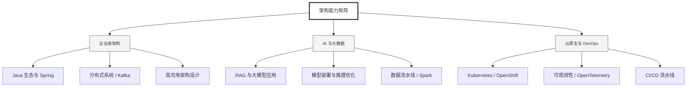

  <h1>你好，我是 Ellen Liu 👋</h1>
  

    <a href="README.md">English</a> | 
    <b>简体中文</b>
  

## 🧠 技术栈与核心能力

智能化企业系统建设路线图，涵盖全栈人工智能工程、云基础设施架构及模型部署等核心技术领域。

## 🚀 Highlighted 工作

- **开源 AI 项目**: [基于 BERT 的声明检测模型](https://huggingface.co/XiaojingEllen/bert-finetuned-claim-detection) (Apache-2.0)
  - *已被哥伦比亚大学 (UBC) 研究项目引用。*
  - *手写 Transformer 核心代码，以验证理论与工程的一致性。*
- **金融基础设施**: 从 0 到 1 构建数字银行支付中间件及智能保险理赔系统。

## 📑 每日论文速递 (ArXiv)
<!-- DAILY_ARXIV_SUMMARY_START -->
**更新日期: 2026-11-10**

### 1. [SMO：将自然语言技能编译为可复用状态-移动-结果积木图](http://arxiv.org/abs/2611.12041v1)
- **摘要**: 大型语言模型智能体日益依赖可复用的自然语言技能，然而不断增长的技能集合仍然只是孤立文本产物的累积，难以比较、去重和组合。我们认为，技能的可复用内容不在于其表层措辞，而在于其过程性转移：在给定状态下执行何种操作，以及产生何种可观测结果。基于这一观察，我们提出State-Move-Outcome（SMO），一个类编译框架，它将原始技能分解为可复用的过程性积木，并将获准的积木组织为外化的符号结构。在编译技能时，SMO首先检索并组合现有积木，通过Outcome-to-State条件动态连接它们，并且只为未被覆盖的过程创建候选积木；候选积木只有在经过验证和获准后才变为可复用。在SkillsBench v1.1上的实验表明，SMO用95个共享积木表示来自87个底层任务的232个rawSkills，将相应的技能表示从366,472个token减少到149,154个token——实现了$\mathbf{59.3}\times$的缩减和$\mathbf{2.46}\times$的压缩。在232个以技能为条件的评估实例中，SMO将平均任务得分从$\mathbf{0.6379}$提升到$\mathbf{0.7478}$，并将5/5 Pass实例从$\mathbf{138}$增加到$\mathbf{164}$，同时在$\mathbf{232}$个实例中的$\mathbf{208}$个上达到或超过rawSkill。它还将平均运行时token消耗降低了$\mathbf{38.38\%}$。这些结果表明，将自然语言技能编译为共享的过程性单元，可以共同提升技能复用、表示效率和下游执行。

### 2. [Infrathon：面向真实世界长周期AI基础设施优化的语言智能体基准测试](http://arxiv.org/abs/2611.11995v1)
- **摘要**: 在本工作中，我们研究前沿智能体能否在长周期内持续改进真实世界的AI基础设施。我们提出Infrathon，一个涵盖不同层次的多样化长周期AI基础设施优化任务基准。我们在24小时预算下对六个模型进行了150次运行评估，总计超过10,000 GPU小时。结果表明，模型排名随评估周期而变化，同时150次运行中有135次在预算后半段实现了进一步改进。这些发现表明，较短的评估可能同时忽略优化收益和模型相对性能的变化。我们还发现，智能体能够发现优于人工设计基线的解决方案：Claude Opus 5.5将平均KV缓存压缩率从人工设计的Quant-VideoGen编解码器的6.82%提升至19.86%。对智能体轨迹的分析识别出任务违规、不可靠测试和过早完成是持续改进的障碍。总之，我们的Infrathon框架为构建长周期任务、评估前沿智能体和发现优质基础设施解决方案提供了资源。

### 3. [EmoHarness：通过元工具框架演化提升多模态情感理解](http://arxiv.org/abs/2611.11994v1)
- **摘要**: 小型多模态模型在词语、语音和视觉线索相互冲突时可能会误判情绪。我们提出 EmoHarness，它将此类模型（即冻结的学生模型）置于一个测试框架中运行：该框架包含围绕其调用的提示词、设置和验证代码。由人工编写的初始框架（即脚手架）将学生模型的视觉观察、转录文本和韵律描述编号为可引用的证据，并让学生模型据此权衡候选情绪。在 Meta-Harness Evolving（MHE）中，一个更强的 LLM（即构建器）离线读取学生模型的错误和执行轨迹并编辑框架；静态检查和验证门决定保留哪些编辑，且构建器从不接触评估项目。在 5,507 个 MME-Emotion 项目上，对于全部四个学生模型和两个构建器，EmoHarness 相较单次纯视频调用将任务宏识别率提升了 7.6–13.4 个百分点。转录文本和韵律描述贡献了大部分提升（+5.38 至 +10.71）；脚手架使音频增强调用变化 -0.79 至 +2.54，部分原因是产生了额外的多标签预测，而演化编辑最多增加 +0.95，尽管没有任何演化增量通过 Holm 校正。该框架的情绪上下文还可迁移至 IntentQA，四个学生模型中有三个获得小幅提升，但均未通过校正。因此，EmoHarness 主要通过提供并组织音频衍生证据来提升小型多模态学生模型的表现。

<!-- DAILY_ARXIV_SUMMARY_END -->

## 🌐 保持联系

  
<i>期待与您探讨 AI 基础设施的未来！</i>

