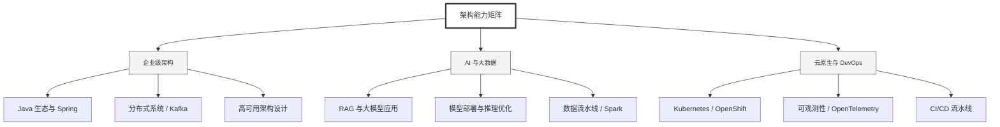

  <h1>你好，我是 Ellen Liu 👋</h1>
  

    <a href="README.md">English</a> | 
    <b>简体中文</b>
  

## 🧠 技术栈与核心能力

智能化企业系统建设路线图，涵盖全栈人工智能工程、云基础设施架构及模型部署等核心技术领域。

## 🚀 Highlighted 工作

- **开源 AI 项目**: [基于 BERT 的声明检测模型](https://huggingface.co/XiaojingEllen/bert-finetuned-claim-detection) (Apache-2.0)
  - *已被哥伦比亚大学 (UBC) 研究项目引用。*
  - *手写 Transformer 核心代码，以验证理论与工程的一致性。*
- **金融基础设施**: 从 0 到 1 构建数字银行支付中间件及智能保险理赔系统。

## 📑 每日论文速递 (ArXiv)
<!-- DAILY_ARXIV_SUMMARY_START -->
**更新日期: 2026-11-17**

### 1. [面向大型语言模型长期记忆的即时权重空间整合](http://arxiv.org/abs/2611.20759v1)
- **摘要**: Agentic记忆系统通过将经验提取为文本并在查询时检索，为LLM提供持久记忆，但模型本身并不进化：无论经历过多少次交互，它在每次查询时都从相同状态开始。提取误差会累积，任何单一片段都未明确表述的隐式跨会话模式无法被呈现，且构建成本随每次对话而增长。对过往交互进行微调确实会改变权重，但需要在服务时进行反向传播，并且在长历史上会退化。我们提出CLAM（Carried Latent Adapter Memory），它结合了两者的优势：循环超网络执行参数化巩固，在单次前向传播中将会话激活流编译为低秩适配器，无需梯度步骤，也无需语言模型生成调用；而互补的情景缓冲区在推理时提供逐字细节。门控潜在状态以固定大小跨会话携带知识，因此参数化记忆无需增长即可累积。在LoCoMo和LongMemEval-S上，针对三个开放模型（2-7B参数），CLAM以1-45分的优势领先所有agentic基线，以10-45分的优势领先所有基于梯度的参数化方法，同时构建其记忆所需的生成式LLM调用为零、梯度步骤为零，墙钟时间比提取系统少3-151倍。两个通道是互补的：当情景缓冲区错过黄金证据时，巩固后的适配器增加12-15个准确率点，即使使用oracle缓冲区也仍增加4-5个点。

### 2. [GPRM：全局视角过程奖励模型](http://arxiv.org/abs/2611.20755v1)
- **摘要**: 过程奖励模型（PRM）被广泛用于大语言模型多步推理的步骤级评估，但现有方法往往受限于较弱的历史依赖建模和不足的全局感知能力。它们通常无法利用先前步骤的评估来进行连贯判断，也缺乏对后续推理的可见性，导致对中间步骤的评估欠佳。为解决这一问题，我们提出了全局视角过程奖励模型（GPRM），该模型联合建模问题、先前的推理步骤及其评估、当前步骤以及未来步骤，从而实现具有历史感知和全局信息的过程评估。我们进一步引入了一个沿四个维度——回顾、前瞻、自检和目标对齐——的结构化评估框架，以评估先前一致性、未来合理性、步骤有效性和任务对齐。基于该框架，我们构建了用于监督微调（SFT）和强化学习（GRPO）的数据集。实验表明，尽管使用的训练数据更少、模型规模更小，GPRM在PRMBench和ProcessBench上分别以7.8分和5.4分优于强基线模型。GPRM还具有良好的跨任务泛化能力，在Agent Error Bench上超越GPT-4.1基线，在测试时扩展（TTS）下将强基线提升约4分，并在PPE上取得有竞争力的性能。

### 3. [大型语言模型能给出好的产品建议吗？一个诊断失败的框架](http://arxiv.org/abs/2611.20734v1)
- **摘要**: 评估语言模型提供的产品建议，需要判断该推荐是否满足用户需求，并在不满足时识别模型的不足之处。然而，仅凭匹配在线回复中提到的产品无法单独回答这两个问题：可能有多个产品都适合，而记录下来的答案本身也可能是不佳的建议。当向六个模型同时展示社区列出的替代产品与其自身采样的汽车推荐时，在符合条件的意见分歧中，有1.9%至6.5%的情况模型更偏好替代产品，且在两种来源盲呈现顺序下均保持一致。我们提出了一个诊断框架，将用户陈述的需求、模型添加的假设、候选生成、筛选和最终选择分开，并列出19种可能的失败模式及评估这些模式所需的证据。我们将该框架应用于产品建议数据以及一个单独的产品选择任务（该任务具有外部指定的相关性标签）。实验区分了提及社区列出的产品与选择该产品，并展示了答案提取和候选列表构建如何影响结果。

<!-- DAILY_ARXIV_SUMMARY_END -->

## 🌐 保持联系

  
<i>期待与您探讨 AI 基础设施的未来！</i>

