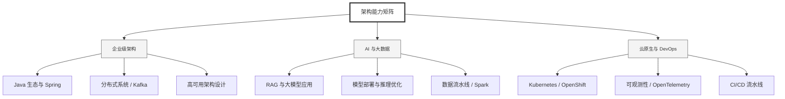

  <h1>你好，我是 Ellen Liu 👋</h1>
  

    <a href="README.md">English</a> | 
    <b>简体中文</b>
  

## 🧠 技术栈与核心能力

智能化企业系统建设路线图，涵盖全栈人工智能工程、云基础设施架构及模型部署等核心技术领域。

## 🚀 Highlighted 工作

- **开源 AI 项目**: [基于 BERT 的声明检测模型](https://huggingface.co/XiaojingEllen/bert-finetuned-claim-detection) (Apache-2.0)
  - *已被哥伦比亚大学 (UBC) 研究项目引用。*
  - *手写 Transformer 核心代码，以验证理论与工程的一致性。*
- **金融基础设施**: 从 0 到 1 构建数字银行支付中间件及智能保险理赔系统。

## 📑 每日论文速递 (ArXiv)
<!-- DAILY_ARXIV_SUMMARY_START -->
**更新日期: 2026-10-26**

### 1. [训练前先度量：类型化决策模型与经典基线及生成式LLM在个人多语言收件箱路由中的比较](http://arxiv.org/abs/2610.32955v1)
- **摘要**: 个人邮件代理会对每封邮件做出判断：它是什么、是否紧急、是否起草回复、创建任务还是忽略。其错误率很少被测量：存储的标签是由系统自身写入的。我们提出 Foyer——一个日常使用的自托管个人收件箱代理，以及一套测量协议（分层采样、冻结快照、按线程分组划分、预注册假设、在代理审核循环中引入人工标签），该协议在任何训练之前即可产出真实基准。在由所有者标注的 739 封真实意大利语/英语邮件上（231 封无偏样本，500 封对抗性采样），我们在按线程分组交叉验证下比较了九个系统：生产环境的关键词规则、TF-IDF + 逻辑回归基线、本地类型化决策模型（Tev1、Nimble）、托管决策模型（Nimble v4-max），以及托管生成式大语言模型（Qwen2.5-7B、Gemma 4 26B/31B）。四项结果如下。生产规则在邮件类型上的得分为 28%，而多数类基线为 58%：展示最醒目的字段不携带任何信息。在约 200 个标签下，逻辑回归在每个字段上均取得最高准确率（类型 0.79、紧急度 0.74、需回复 0.83、是否为噪声 0.90），尽管它从不预测两个最稀有的类别，且在类型上与 Gemma 4 在统计上持平；少样本提示无法弥合这一差距。发件人的关系（客户、供应商、服务商）在联系人已被见过的情况下，可从同一联系人的其他邮件中以 98.6% 的准确率恢复，且任何模型都无法从单封邮件中推断出来：它属于联系人图谱，而非提示词。最后，准确率并非产品指标：将其组合为动作后，最准确的系统最常忽略需要处理的邮件（18%，而最佳 LLM 为 4%）；在其噪声概率上按成本选择的阈值可将该比率减半，并使其成为成本最低的系统。

### 2. [“真”与“假”相加等于一吗？LLM智能体意见模拟中的补集一致性](http://arxiv.org/abs/2610.32874v1)
- **摘要**: 在大语言模型智能体意见模拟中，每个智能体在观察到自身先前的概率以及邻居所报告的概率后，会报告某一主张为真的概率，而该数值成为其在下一轮中的状态。如果该数值描述的是智能体的立场，而非其所看到的句子，那么将该主张改写为其否定形式，并将每个概率p替换为1 - p，应当返回互补的答案，因此两份报告之和应为1。我们用三个小型开放模型对此进行测试：Qwen3-4B、Llama-3.2-3B和Gemma-3-4B。在取自一个运行中的网络模拟的2,304个智能体状态上，Qwen的成对报告平均之和为1.18；而在来自AVeriTeC的48个真实事实核查主张上，其和同样超过1。一个包含24个世界的受控基准测试——每个世界恰好有两种可能结果——在全部三个模型中都显示出同样的失败。该差异比同义改写所产生的变化大两到十倍，并且在重复采样、不同同伴群体规模以及不同报告强度下持续存在。当这些报告被反馈到两个从互补状态开始的人群中时，两个人群并未保持镜像关系：对每个模型而言，经过五轮后其分歧均为正值。将每个答案与其配对答案的补值取平均，按构造即可恢复一致性，并降低在两种措辞上平均的Brier损失，但在最后一轮，它仅对三个模型中的一个优于两种原始措辞中较好的那一种。在同一模型上进行的按目标调度实验给出了一个小而稳定的交互效应，因为此类扫描保持主张措辞固定。因此，在将模拟概率解读为信念之前，改写下的一致性需要有其自身的检验。

### 3. [J-Comm：雅可比引导的LLM智能体间潜在通信](http://arxiv.org/abs/2610.32871v1)
- **摘要**: 潜在通信既需要一个有效的连续推理过程，也需要一个接口，使外部模型能够利用其中间计算。我们提出J-Comm，一个由两个核心组件构成的框架。首先，一种免训练的潜推理几何一致性（GEAR）机制在现有模型嵌入上对候选词元重新加权，从而在每一步单调地优化嵌入空间中候选词元之间的几何共识。其次，我们引入H+J（Hidden-and-Jacobian）通信接口，为接收方提供发送方推理的两种互补视图。H通道提供由反馈分布导出的连续输入，而J通道以词汇索引的雅可比透镜坐标传递中间状态线索。直观地说，H为接收方提供推理所依据的输入，而J在其计算过程中提供额外引导。接收方使用自身的词典重建这些线索，并在预填充阶段将其注入中间层，从而在无需共享键值缓存或要求相同模型宽度的情况下实现通信。在Qwen3-8B到Qwen3-4B的通信中，J-Comm在七个基准上取得最高平均分，包括MATH500上的94.80%、GPQA-Diamond上的54.55%、AIME2024+2025上的73.33%，以及ALFWorld上的62.93%成功率。与TextMAS相比，其性能提升1.29-8.59个百分点，并将生成的文本词元减少19.2-74.8%。

<!-- DAILY_ARXIV_SUMMARY_END -->

## 🌐 保持联系

  
<i>期待与您探讨 AI 基础设施的未来！</i>

