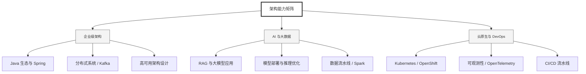

  <h1>你好，我是 Ellen Liu 👋</h1>
  

    <a href="README.md">English</a> | 
    <b>简体中文</b>
  

## 🧠 技术栈与核心能力

智能化企业系统建设路线图，涵盖全栈人工智能工程、云基础设施架构及模型部署等核心技术领域。

## 🚀 Highlighted 工作

- **开源 AI 项目**: [基于 BERT 的声明检测模型](https://huggingface.co/XiaojingEllen/bert-finetuned-claim-detection) (Apache-2.0)
  - *已被哥伦比亚大学 (UBC) 研究项目引用。*
  - *手写 Transformer 核心代码，以验证理论与工程的一致性。*
- **金融基础设施**: 从 0 到 1 构建数字银行支付中间件及智能保险理赔系统。

## 📑 每日论文速递 (ArXiv)
<!-- DAILY_ARXIV_SUMMARY_START -->
**更新日期: 2026-10-27**

### 1. [有用的多样性还是幻觉的多样性？面向电子商务搜索的基于人物设定的合成查询生成](http://arxiv.org/abs/2610.35102v1)
- **摘要**: 合成监督可以为新的搜索领域引导语义解析器，但提示诱导的多样性只有在生成内容忠实于结构化意图时才有用。我们在冷启动电子商务搜索中探索了这一点：在47字段的英国汽车模式上，由6个LLM使用9个角色条件化提示家族生成了118,098个合成对，并与1,214个人工标注查询和15,304个生产查询进行对比。我们表明，IPIP人格捆绑在所有四个匹配对比中都提高了解析器F1（Holm校正后$p<.001$），并且所有三个捆绑在完整的$2^3$网格上都具有正向主效应。语法条件化是使生成内容向真实流量靠拢的轴。它还会诱导词汇多样性。对齐sKL，即拟合到合成查询和人工标注查询的von Mises-Fisher分布之间的散度，是解析器F1的无标签代理（针对为模拟购物者场景编写的人工查询，$ρ=-0.917$，越低越接近）。一个LLM委员会对照盲审作者复核，对每个解析器都漏掉的927个查询进行分诊，并将37%标记为幻觉。被丢弃的约束占主导。四个带语法的家族具有最大的幻觉占比，为38%至42%，而仅IPIP最低，为28%。

### 2. [对抗厌女症的RAG：改进隐性厌女症解释](http://arxiv.org/abs/2610.35094v1)
- **摘要**: 隐性厌女往往需要背景知识才能被理解。为应对这一挑战，我们提出一个检索增强生成（RAG）框架，用于检测和解释英语和意大利语中的隐性厌女，并利用百科、俚语和女性主义知识来源。我们使用 ImplicIT-Mis 和 SBIC+ 数据集，评估每种知识来源对检测和解释质量的贡献，同时探究 RAG 是否解决了已知的 LLM 在隐性厌女方面的失效模式。结果表明，RAG 提高了 ImplicIT-Mis 上的召回率，但并未改善 SBIC+ 上的检测性能。然而，人工评估显示，在两种语言中，基于 RAG 的解释均优于无 RAG 的解释。女性主义文献成为对检测和解释最 consistently 有用的来源。

### 3. [先问后答：一种面向上下文学习的问题驱动证据推理架构（QERA）](http://arxiv.org/abs/2610.35083v1)
- **摘要**: AI助手越来越多地被要求基于用户自身的网络痕迹进行推理：群聊、社区帖子、活动日志和修订历史。在CL-bench Life这一针对此类真实生活上下文学习的基准测试中，前沿大语言模型（LLM）解决的任务不足五分之一。我们发现，请求并不等同于规范：该基准测试中超过80%的评分标准与最终请求共享的内容词不足60%，例如两轮之前的规则集或符合用户标准的每一条记录，而直接作答的LLM仅通过其中67%的隐性评分标准，对其他评分标准的通过率为81%。我们提出QERA，一种问题驱动的证据推理架构，先提问再作答。QERA首先将请求转化为需求清单和带类型的信息需求，并通过代码过滤以确保忠实于用户的原话；随后从整个对话中作答，用经代码验证的引文再次提出相同问题，并应用受保护的局部修复。它无需训练或评分标准，每个任务约进行四次LLM调用。在全部405个任务上，使用四个前沿LLM时，QERA在每个LLM上都取得了最高的解决率（平均21.0%，而三种推理时基线中最强者为18.2%，直接作答为14.6%），并且在跨LLM汇总时显著领先所有基线，同时使用的token少于PSCI，仅为Ctx2Skill的4-5%。在GPT-6-Luna上的消融实验表明，增益在作答之前就已确定，来自固定的作答协议（+3.8个评分标准点）和针对请求的问题（+1.6），且增益集中在隐性评分标准上，事后检查主要细化数值要求。

<!-- DAILY_ARXIV_SUMMARY_END -->

## 🌐 保持联系

  
<i>期待与您探讨 AI 基础设施的未来！</i>

