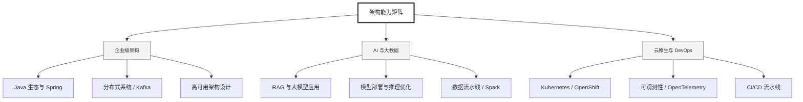

  <h1>你好，我是 Ellen Liu 👋</h1>
  

    <a href="README.md">English</a> | 
    <b>简体中文</b>
  

## 🧠 技术栈与核心能力

智能化企业系统建设路线图，涵盖全栈人工智能工程、云基础设施架构及模型部署等核心技术领域。

## 🚀 Highlighted 工作

- **开源 AI 项目**: [基于 BERT 的声明检测模型](https://huggingface.co/XiaojingEllen/bert-finetuned-claim-detection) (Apache-2.0)
  - *已被哥伦比亚大学 (UBC) 研究项目引用。*
  - *手写 Transformer 核心代码，以验证理论与工程的一致性。*
- **金融基础设施**: 从 0 到 1 构建数字银行支付中间件及智能保险理赔系统。

## 📑 每日论文速递 (ArXiv)
<!-- DAILY_ARXIV_SUMMARY_START -->
**更新日期: 2026-11-23**

### 1. [MemOnce：面向大型语言模型的可扩展内存架构](http://arxiv.org/abs/2611.27973v1)
- **摘要**: 在长时程和持续交互中部署大型语言模型（LLM）需要为未来推理维护可复用的记忆状态，这给现有架构带来了挑战。标准Transformer会累积逐层、词元级的KV缓存，随着上下文扩展，导致GPU内存线性增长和计算复杂度呈二次方增长。相比之下，线性时间架构将历史压缩为固定大小的状态，但难以保留细粒度细节。我们提出MemOnce，一种为语言模型学习可扩展记忆状态的基础架构。MemOnce基于两个核心设计：（a）记忆编码器-解码器：它仅缓存最后一层隐藏状态的一小部分作为紧凑的记忆表示，并动态将其解码回注意力层的KV缓存；（b）记忆稀疏注意力：对于每个持续输入，MemOnce自适应地检索相关记忆表示，稀疏索引仅在跨层计算一次。这两种设计的耦合实现了高效的即时记忆加载和KV缓存解码，大幅减少GPU内存占用并实现线性时间复杂度。我们进行了大量实验，表明MemOnce在不同模型规模、上下文长度和训练范式（预训练和后训练适配）下均优于Transformer和其他架构。特别是，使用MemOnce适配Qwen3.5-4B在1M上下文下将记忆状态缓存减少1313倍、预填充延迟降低6.9倍，并将吞吐量提高3.5倍、整体记忆性能提升+5.77%。最后，MemOnce可零样本泛化到下游表示任务，取得与专用模型相竞争的结果。

### 2. [TEA-Bench-BR：编码智能体能否将分支临床规范转化为正确代码？](http://arxiv.org/abs/2611.27895v1)
- **摘要**: 编码智能体日益承担执行领域专家所编写规则的任务，而此类代码中的缺陷往往是静默的：程序照常运行并返回看似合理的答案。我们提出TEA-Bench-BR，这是一个基于巴西早期自闭症（TEA）筛查路径构建的基准：包含三个具有真实工具结构的虚构工具、一套多专业转诊流程，以及按国家RNDS规范导出为FHIR R4，全部以葡萄牙语规定。一个生成器对每个任务的参数进行采样（144个任务，6,798个隐藏用例），这些隐藏用例能够杀死参考实现全部1,955个非等价变异体。以Gemma 4作为智能体时，12B模型解决了38.0%的单工具任务，但在FHIR层面一个也未解决；31B模型在第1至第3层级分别解决了77.8%、85.2%和78.7%，并通过了超过99%的隐藏用例，其剩余失败大多出现在输入验证而非临床决策上。在相同任务以英语呈现时，31B模型在第3层级解决了57.4%，因为其代码对标识符的验证频率较低；而12B模型的验证频率则较高。12B模型漏掉了10.10%需要转诊的用例；31B模型仅漏掉0.02%。在一项针对修改版PHQ-9的污染探测中，未发现任何遵循原始规则的错误。

### 3. [DistDNA：随机解码下的语言模型指纹识别](http://arxiv.org/abs/2611.27831v1)
- **摘要**: 行为指纹通过模型对一组共享提示的响应来识别大型语言模型（LLM），从而支持诸如验证部署模型是否与其声称的检查点相对应等应用。然而，部署模型通常采用随机解码方式提供服务，在此方式下，同一模型对相同提示可能产生不同的响应，具体取决于未知的温度和 top-$p$ 设置。现有表示方法（如 LLM DNA）对这种变化的处理较为有限。一种自然的补救措施是通过模型的响应分布来刻画模型，但这带来了两个挑战。首先，每个分布只能从少量采样响应中估计。其次，解码设置的变化对响应的影响程度可能与检查点的变化相当。因此，仅凭指纹距离无法为模型身份提供完整依据，识别通常依赖于在来自多个检查点的指纹上联合训练的分类器。我们提出 DistDNA，它通过提示条件响应分布来表示模型，并通过逐提示最大均值差异（MMD）来比较模型。待检验的模型被分配给已知检查点中参考指纹（在多种解码设置下收集）与其自身指纹最接近的那个，而无需训练分类器。我们证明，有限采样会在期望平方指纹距离中引入依赖于方差的项，在响应数量相等的情况下，这些项以 $O(1/R)$ 的速率递减，其中 $R$ 是每个提示的响应数量。在 115 个模型检查点条目上的实验表明，DistDNA 相比最强基线 LLM DNA 将识别准确率提高了 10.36%。

<!-- DAILY_ARXIV_SUMMARY_END -->

## 🌐 保持联系

  
<i>期待与您探讨 AI 基础设施的未来！</i>

