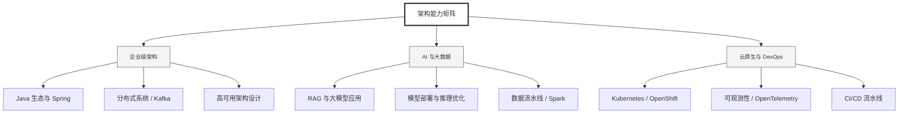

  <h1>你好，我是 Ellen Liu 👋</h1>
  

    <a href="README.md">English</a> | 
    <b>简体中文</b>
  

## 🧠 技术栈与核心能力

智能化企业系统建设路线图，涵盖全栈人工智能工程、云基础设施架构及模型部署等核心技术领域。

## 🚀 Highlighted 工作

- **开源 AI 项目**: [基于 BERT 的声明检测模型](https://huggingface.co/XiaojingEllen/bert-finetuned-claim-detection) (Apache-2.0)
  - *已被哥伦比亚大学 (UBC) 研究项目引用。*
  - *手写 Transformer 核心代码，以验证理论与工程的一致性。*
- **金融基础设施**: 从 0 到 1 构建数字银行支付中间件及智能保险理赔系统。

## 📑 每日论文速递 (ArXiv)
<!-- DAILY_ARXIV_SUMMARY_START -->
**更新日期: 2026-11-07**

### 1. [MedGraph：利用图记忆维护长期医疗对话中的患者状态](http://arxiv.org/abs/2611.08433v1)
- **摘要**: 基于大语言模型的医疗助手若要在多次就诊中持续跟踪患者，就需要一种能在患者临床状态变化时保持其正确的记忆机制。我们考察了五种记忆系统在纵向医疗对话中的错误，发现三类反复出现的原因：检索到的证据给出过时状态、包含他人的健康事实，或缺少答案所依赖的安全性事实。我们提出MedGraph，一种针对这三种情况构建的图记忆。其构建过程从每次会话中提取带日期的医疗事实，将每条事实归属到其所描述的人，并把用药、诊断和测量记录链接成保留早期状态的链。检索时以患者为单位对链进行排序，按问题所询问的时间点读取每条链，并补充原始对话文本；患者档案则列出每条记录在案的安全性事实及每个问题。在MedMemoryBench上，MedGraph在GPT和Qwen两种骨干模型下均取得最高总体准确率，分别比五个基线中最强者高出10.5和10.4分，且在GPT设置下具有高效的记忆构建与回答能力。

### 2. [重复社会互动中的文化适应](http://arxiv.org/abs/2611.08334v1)
- **摘要**: 人类文化的大部分内容是隐性的，通常通过情境化的社会互动来习得。随着大语言模型作为交互式智能体被部署到多元社区中，评估其文化能力要求我们超越现有的问答式方法，从“它们知道什么”转向“它们如何适应”。在本研究中，我们通过沙盒环境考察大语言模型能否在反复互动中实现适应，从而拓宽了NLP中文化适应的研究范围。通过将文化适应重新定义为通过社会互动持续同化规范的过程，我们的工作表明，记忆机制能够促进跨反复互动的纵向学习，促进向不同社会环境的迁移，并实现跨五种语言的多语言规范同化。总体而言，我们的发现为大语言模型中持续的、互动驱动的文化适应奠定了基础。

### 3. [在异构认知与生物医学知识图谱上对大型语言模型进行基准测试：图接地在多跳推理与幻觉缓解中的作用](http://arxiv.org/abs/2611.08315v1)
- **摘要**: 大型语言模型（LLMs）在生物医学和认知神经科学中的应用日益广泛，但其在异构知识图谱（KGs）上进行可靠推理的能力仍不明确。我们在五个知识图谱——DrugBank、NeuroSynth、Cognitive Atlas、Brain Map和GDPKG——上对五个LLMs（GPT-5.1、Gemini 2.0 Pro、Llama 3、Qwen和BioGPT）进行了基准测试。我们引入了一个多层查询数据集，用于在知识图谱感知（图接地）和知识图谱不可知条件下评估推理深度和事实准确性。标注者间一致性较高，Cohen's kappa为0.781（范围：0.753-0.807），Fleiss' kappa为0.77。结果表明，通用模型，尤其是GPT-5.1和Gemini 2.0 Pro，在多跳和高层次推理任务上通常优于领域特定模型，尽管性能会随查询复杂度增加而下降。知识图谱接地降低了所有评估模型的幻觉率。与我们的初始假设相反，在没有图接地的情况下，领域特定模型在专业任务上并不始终优于通用模型。这些发现凸显了将广泛的语言模型能力与结构化领域知识相结合的价值。我们根据任务复杂度和计算约束，为选择LLM-KG集成策略提供了实用指导，并讨论了个性化医疗、认知障碍诊断和可解释AI的混合神经符号架构。

<!-- DAILY_ARXIV_SUMMARY_END -->

## 🌐 保持联系

  
<i>期待与您探讨 AI 基础设施的未来！</i>

