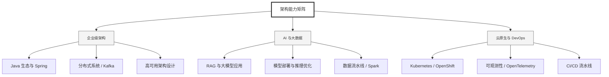

  <h1>你好，我是 Ellen Liu 👋</h1>
  

    <a href="README.md">English</a> | 
    <b>简体中文</b>
  

## 🧠 技术栈与核心能力

智能化企业系统建设路线图，涵盖全栈人工智能工程、云基础设施架构及模型部署等核心技术领域。

## 🚀 Highlighted 工作

- **开源 AI 项目**: [基于 BERT 的声明检测模型](https://huggingface.co/XiaojingEllen/bert-finetuned-claim-detection) (Apache-2.0)
  - *已被哥伦比亚大学 (UBC) 研究项目引用。*
  - *手写 Transformer 核心代码，以验证理论与工程的一致性。*
- **金融基础设施**: 从 0 到 1 构建数字银行支付中间件及智能保险理赔系统。

## 📑 每日论文速递 (ArXiv)
<!-- DAILY_ARXIV_SUMMARY_START -->
**更新日期: 2026-10-31**

### 1. [阐明语言模型数据归因的设计空间](http://arxiv.org/abs/2610.40655v1)
- **摘要**: 语言模型（LM）的数据归因方法通常通过事实检索等下游任务进行评估。然而，现有评估同时改变多个数据集属性，导致无法准确判断归因算法失败的具体原因。为诊断这些失败，我们探索了LLM数据归因的设计空间，主要聚焦于评估环节。我们提出了用于事实追踪的受控归因基准（CATT），在该基准中，我们在完全虚构的知识上微调LLM，为归因提供明确无误的真实标注。这一合成设置使我们能够系统地每次仅改变一个数据集配置，例如文档冗余和词汇干扰项。借助这种可配置的评估，我们证明冗余和干扰项会持续降低归因性能。我们没有提出新的估计器，而是考察了两个尚未充分探索的设计选择：用于计算梯度的损失函数，以及如何将逐token归因分数聚合为文档分数。我们发现，训练文档中真正的因果证据高度局部化，但标准方法通过对整个文档的归因分数取平均，将这一证据稀释为噪声。我们发现，用负对数几率梯度替代标准交叉熵损失梯度，能够从其他无信息token中凸显出关键token。随后，我们仅聚合得分最高的token分数，在我们的诊断基准上，使多个基线方法的真实标注召回率提升了35至72个百分点。负对数几率校正还可推广至FTRACE-TREX，使我们测试的每种方法的反事实重训练性能均得到提升，最高提升达4.9倍。

### 2. [ShallowDefend：利用浅层安全对齐实现多轮防御](http://arxiv.org/abs/2610.40627v1)
- **摘要**: 安全对齐已使大语言模型能够可靠地直接拒绝有害请求，然而，当同一请求分散在多轮对话中时，仍然过于频繁地得逞。这种脆弱性有其机制层面的根源：对齐是浅层的，安全行为集中在模型最初几个输出token上，而现有防御继承了这一弱点，只对回复的表面形式进行监督，从未让模型学习一个明确的安全决策。我们对浅层性持相反观点：如果一段很短的跨度决定整个回复的轨迹，那么这段跨度就是干预杠杆率最高的位置，而防御方可以先占据它。我们提出“评估→决策→回复”（Assess $\to$ Decide $\to$ Respond）框架，防御方先评估用户意图，做出一个明确、可解析的安全决策，然后才以该决策为条件生成回复，并在载荷轮次通过强化学习训练这一承诺。由于决策是一个token跨度，奖励可以是一条规则：自验证奖励将承诺的标签与对话的已知性质进行核对，无需评判器，也无需标注；同时，同一格式也支持在带安全重定向的分级决策空间上使用LLM-as-judge奖励。在两个模型家族和涵盖安全性、效用与有用性的十四个基准上，我们的防御方在受控比较中实现了最强的多轮安全性，在保持安全性领先的同时维持了效用，仅以适度的有用性代价为成本。逐token KL分析和干预性探针证实了其有效原因：训练将效果集中在设定回复轨迹的简短斟酌上，而在此处承诺的决策是一个因果控制点。攻击者所利用的浅层性，恰恰成为防御的机制。

### 3. [TextSeal2：基于Copula混合与无记忆竞争的无失真LLM水印](http://arxiv.org/abs/2610.40613v1)
- **摘要**: 我们提出TextSeal2，一种面向大语言模型的无失真水印，在推测解码下仍能保持其信号：替换被拒草稿的令牌仍使用相同密钥进行水印标记，且接受率保持不变。它还保持了输出多样性，并且没有增加可测量的推理延迟。其前身TextSeal通过抛硬币将每个令牌路由到两个密钥之一，从而在Gumbel-max方案中恢复多样性。这种做法并非最优，因为检测器在不知道使用了哪个密钥的情况下对两个密钥的分数取平均。TextSeal2则改为将两个或多个密钥合并为单个虚拟密钥，并通过AutoMark的高斯Copula将其与新鲜噪声耦合。任意数量的密钥，包括公开共享的密钥，都可以通过这种方式合并，而不会稀释检测。在推测解码下，TextSeal2通过额外一次指数竞赛来验证带密钥的草稿，该竞赛在草稿竞赛的剩余部分上运行。根据无记忆性，该竞赛复现了块验证，因此输出完全遵循目标模型。我们在三个大语言模型上评估了TextSeal2。在相同的输出令牌多样性下，在$10^{-3}$的假阳性率下，TextSeal2比TextSeal多检测出8至22个百分点的100令牌答案，并且与textGrain相当，同时无需后logits优化。在推测解码下，在相同接受率下，它比TextSeal和textGrain分别多检测出18和22个百分点的200令牌答案。

<!-- DAILY_ARXIV_SUMMARY_END -->

## 🌐 保持联系

  
<i>期待与您探讨 AI 基础设施的未来！</i>

