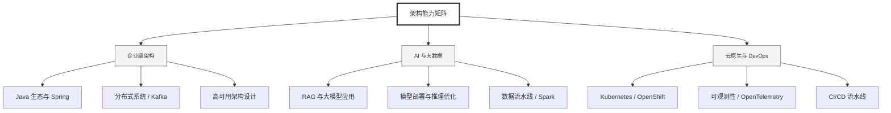

  <h1>你好，我是 Ellen Liu 👋</h1>
  

    <a href="README.md">English</a> | 
    <b>简体中文</b>
  

## 🧠 技术栈与核心能力

智能化企业系统建设路线图，涵盖全栈人工智能工程、云基础设施架构及模型部署等核心技术领域。

## 🚀 Highlighted 工作

- **开源 AI 项目**: [基于 BERT 的声明检测模型](https://huggingface.co/XiaojingEllen/bert-finetuned-claim-detection) (Apache-2.0)
  - *已被哥伦比亚大学 (UBC) 研究项目引用。*
  - *手写 Transformer 核心代码，以验证理论与工程的一致性。*
- **金融基础设施**: 从 0 到 1 构建数字银行支付中间件及智能保险理赔系统。

## 📑 每日论文速递 (ArXiv)
<!-- DAILY_ARXIV_SUMMARY_START -->
**更新日期: 2026-11-15**

### 1. [ArchSpace：记录、审阅与引用LLM架构研究](http://arxiv.org/abs/2611.17332v1)
- **摘要**: 模型架构决定了LLM的缩放行为、训练效率和推理成本，因而成为产业界与学术界共同关注的核心。在产业界，DeepSeek、Qwen和Kimi等团队经常引入架构创新，但公开报告很少记录哪些想法成功了、哪些被放弃以及原因何在。在学术界，有限的计算资源和不一致的基线往往使评估局限于小规模、单点比较，难以确定改进是否在更大规模上依然成立，或是否能转化为更广泛的影响。ArchSpace作为面向架构研究的记录、评审与引用公共平台，旨在弥补这两方面的空白：每个提案都连同其实验与推理过程被记录，由社区进行评审，并被后续工作引用。为了在昂贵的大规模训练之前评估想法，ArchSpace利用缩放定律从较小规模的实验预测更大规模下的模型损失，这一做法在产业界被广泛采用。我们提供了使该平台可用的初始参考：Qwen3.5和OLMo3基线、拟合的缩放定律以及可复用的训练配方。通过这一评审流程得到验证的想法反过来可以成为新的基线，ArchSpace由此旨在拓宽塑造下一代模型的想法范围。

### 2. [CoReMem：面向连续编码任务的成本内化记忆与前瞻性估值](http://arxiv.org/abs/2611.17316v1)
- **摘要**: 编码智能体在持续演化的代码仓库上处理接连不断的任务，在下一个任务未知之前就携带既有编辑并写入记忆。为未知的后续任务选择记忆，需要在未来有用性与写入和读取记忆的成本之间取得平衡。行动者还必须判断，在任务展开过程中何时依据可用记忆采取行动能够节省精力。我们提出代码仓库记忆（CoReMem），这是一个成本内化框架，通过实测记忆在下一个任务上的价值来指导记忆设计与行动者适配。前瞻性片段估值在同一继承仓库状态下，比较下一个任务在有和没有单个轨迹片段时的运行情况，从而指导围绕锚点构建紧凑记忆：锚点即仓库位置与可执行检查。行动者适配在包含和不包含记忆的 rollout 组内估计同策略记忆价值，所用奖励优先考虑问题解决，并对成功运行中的步数进行惩罚。来源门控价值信用将额外价值项分配给被识别为使用记忆所提供锚点的步骤，同时每一步都保留结果信用。在 ChainSWE 上，相对于未训练且无记忆的行动者模型，CoReMem 将 27B 行动者的问题解决率从 21.0% 提升至 25.7%，步数减少 17%，总缓存感知 token 数减少 11%（包括记忆模块调用）。

### 3. [大语言模型中的目标编码](http://arxiv.org/abs/2611.17297v1)
- **摘要**: 我们研究大型语言模型是否以及如何编码目标：即先于并引导行动的内部神经表征，且这些表征具有足够的灵活性，能够通过多种不同的执行路径得以实现。我们构建了一个包含多个子任务的编码环境，使我们能够评估目标寻求行为以及子目标的选择。在此环境中，我们在稀疏的一组注意力头的输出中定位到了下一个子目标的编码。相同的注意力头可用于以自然语言解码语言模型的未来行动（例如，“我正在检查一个单词是否是回文”）。我们验证了这种编码对下一个行动具有因果性，并且具有可塑性：将其移植到不同的环境中，例如另一种编程语言，会触发相同的操作，但以不同的词元序列实现。语言模型还会在行动执行过程中持续维持该编码，这一点令人费解，因为一个没有循环结构的Transformer语言模型无法将状态向前传递超过其剩余层数所能承载的词元数量。我们提出它并不需要这样做。在非循环目标寻求（NRGS）解释下，语言模型会频繁地从任务规范中重新读取目标，将其与不断增长的上下文中可见的进展进行比较，并追求剩余的部分。我们通过有针对性的因果干预来检验这一解释的预测。

<!-- DAILY_ARXIV_SUMMARY_END -->

## 🌐 保持联系

  
<i>期待与您探讨 AI 基础设施的未来！</i>

