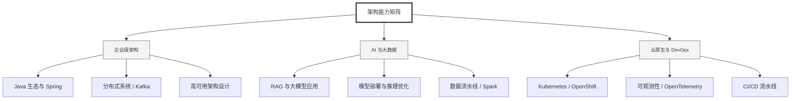

  <h1>你好，我是 Ellen Liu 👋</h1>
  

    <a href="README.md">English</a> | 
    <b>简体中文</b>
  

## 🧠 技术栈与核心能力

智能化企业系统建设路线图，涵盖全栈人工智能工程、云基础设施架构及模型部署等核心技术领域。

## 🚀 Highlighted 工作

- **开源 AI 项目**: [基于 BERT 的声明检测模型](https://huggingface.co/XiaojingEllen/bert-finetuned-claim-detection) (Apache-2.0)
  - *已被哥伦比亚大学 (UBC) 研究项目引用。*
  - *手写 Transformer 核心代码，以验证理论与工程的一致性。*
- **金融基础设施**: 从 0 到 1 构建数字银行支付中间件及智能保险理赔系统。

## 📑 每日论文速递 (ArXiv)
<!-- DAILY_ARXIV_SUMMARY_START -->
**更新日期: 2026-11-05**

### 1. [LLM社交智能体中的上下文增强与选择性鲁棒性框架](http://arxiv.org/abs/2611.06914v1)
- **摘要**: 研究人员将大语言模型用作社会模拟中的智能体，通过向智能体提供观察信息和背景信息来引导其行为。然而已有研究表明，大语言模型智能体在保持语义不变的提示变体下会显著改变其行为，这为社会模拟带来了验证问题。一个合理的假设是，这种脆弱性反映了 grounding（基础性依据）的缺失，并可通过丰富提供给智能体的上下文来缓解。更丰富的上下文能否提升鲁棒性仍不明确，部分原因在于上下文丰富度和鲁棒性很少以支持受控比较的方式被定义。我们通过受控上下文丰富化来回应第一个需求，即一组提示替换规则，系统地丰富不同类型的上下文：中性填充、通用社会背景、描述性决策依据和规范性决策依据。我们通过引入选择性鲁棒性作为验证标准来回应第二个需求：即对保持语义不变的提示变体不敏感，同时对社交世界中与决策相关的变化产生方向性响应。我们在一个类囚徒困境博弈中展示了该框架，说明如何利用它来识别哪些形式的上下文丰富化能产生更理想且更鲁棒的智能体行为。我们发现，这些丰富化形式产生了不同的行为模式，且在所测试的两个模型之间有所差异。

### 2. [SpecCompact：通过槽并行语义推测验证加速LLM智能体上下文压缩](http://arxiv.org/abs/2611.06876v1)
- **摘要**: LLM智能体通过上下文压缩来管理不断增长的交互历史，但使用大模型对长历史进行摘要可能带来显著延迟。因此，压缩需要在信息保留与延迟之间取得平衡。我们观察到，结构化摘要槽在独立生成时能够保留信息。基于这一观察，我们提出SpecCompact，一个通过槽并行语义推测来加速压缩的框架。SpecCompact微调一个小型起草器并并行生成各槽。目标模型验证每个提议行并修复被拒绝的内容，而后续起草则使用更新后的槽前缀。系统优化进一步减少了重复的上下文处理和模型调用。在AppWorld和$τ^3$基准上，使用两个目标模型，SpecCompact相比Hermes风格摘要实现了$2.04$–$5.63\times$的压缩加速。独立的下游评估揭示了依赖于模型和任务的性能权衡。在Hermes内进行的一项用户研究进一步显示中位压缩加速达到$8.68\times$。

### 3. [LongBanana：一个经专家验证的长上下文多参考图像合成基准](http://arxiv.org/abs/2611.06856v1)
- **摘要**: 我们提出LongBanana，据我们所知，这是智能体驱动图像生成时代首个由专家设计并经专家验证的长上下文多参考图像合成基准。该任务要求检索分散的视觉证据、排除干扰项、绑定实体与关系，并基于多张参考图合成一幅连贯的最终图像。LongBanana包含90个精心设计的任务，按3×3分类体系组织；每个任务约含32张参考图像、20项约束和50个评估项，总计4，670个由专家指定的原子评估项。其基于图的评估设计为每个任务实例化参考图像和实体-关系图，再将节点、边和全图层面的义务转化为内容保真度、关系绑定和全局约束满足三个维度的检查清单项。经审核的专家标注包含一个15%的双标注子集，其完全一致率为89.4%，二次加权kappa为0.83。我们进一步提出LongBanana-Gen，一个面向长时程图像生成的智能体执行框架；实验表明，最小化的智能体执行框架优于直接生成，而ReAct-Plan-Exec-Reflect（RPR）工作流通过增强证据 grounding 与修复能力，带来依赖于执行框架的增益。综上，LongBanana为衡量密集视觉证据的使用提供了一个可审计的测试平台，也为开发更强的智能体驱动图像生成系统提供了一个共同目标。代码与数据见项目页面：https://long-banana.com/。

<!-- DAILY_ARXIV_SUMMARY_END -->

## 🌐 保持联系

  
<i>期待与您探讨 AI 基础设施的未来！</i>

