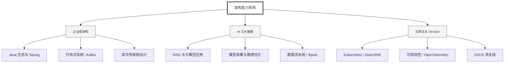

  <h1>你好，我是 Ellen Liu 👋</h1>
  

    <a href="README.md">English</a> | 
    <b>简体中文</b>
  

## 🧠 技术栈与核心能力

智能化企业系统建设路线图，涵盖全栈人工智能工程、云基础设施架构及模型部署等核心技术领域。

## 🚀 Highlighted 工作

- **开源 AI 项目**: [基于 BERT 的声明检测模型](https://huggingface.co/XiaojingEllen/bert-finetuned-claim-detection) (Apache-2.0)
  - *已被哥伦比亚大学 (UBC) 研究项目引用。*
  - *手写 Transformer 核心代码，以验证理论与工程的一致性。*
- **金融基础设施**: 从 0 到 1 构建数字银行支付中间件及智能保险理赔系统。

## 📑 每日论文速递 (ArXiv)
<!-- DAILY_ARXIV_SUMMARY_START -->
**更新日期: 2026-11-11**

### 1. [HandsOnAid：构建并评估面向应急响应场景的离线急救助手](http://arxiv.org/abs/2611.14059v1)
- **摘要**: 紧急情况可能发生在没有手机信号且附近没有救护车的地方。手机上的小型语言模型在此类情况下会有所帮助，但其建议必须安全且准确。我们构建了HandsOnAid，这是一个4位Gemma 2B模型，使用QLoRA在FirstAidQA数据集上进行了微调，该数据集包含5，550个急救问答对。我们比较了七种配置，包括基础模型、4位和8位微调模型，以及带有长度下限、安全门控或检索的版本。我们使用了一个包含41对问答的题库，其参考答案经过医学审核并遵循ANZCOR指南，并采用了严格的0-5分评分标准，包含十二项安全覆盖规则。四个前沿LLM评审（GPT-5.6 Sol、Claude Opus 5、DeepSeek V4 Pro、GLM-5.3）对每个答案进行了盲评，并使用45个隐藏对照来检查评审的可靠性。微调使平均分比基础模型提高了+1.08，达到2.34。最佳配置得分为2.51分（满分5分），即带有检索的微调4位模型。一位医学专业人员还对基础模型、4位微调模型和检索配置的40个答案进行了盲评，其评分与LLM评审的平均分相似。关键词审计发现，训练语料库中对评分标准所要求的ANZCOR指南若干细节的覆盖有限，这表明训练数据中信息缺失可能是低分的一个原因。在智能手机设备（Pixel 7 Pro）上，使用六个CPU线程且无网络连接时，4位微调模型在十个问题上平均于6.86秒后生成首个可显示文本，并于14.88秒后生成完整答案。

### 2. [程序辅助的可修补技能演化](http://arxiv.org/abs/2611.14019v1)
- **摘要**: Agent skills已成为使LLM智能体能够通过编码可复用知识而不修改模型参数来解决复杂交互任务的有效手段。近期方法通过从智能体执行轨迹中提炼可复用经验，并基于下游任务反馈演化技能，进一步改进了技能适应。然而，现有方法主要将技能表示为自然语言文档，将过程逻辑与描述性知识交织在一起，使技能难以维护和演化。为解决这一局限，我们提出PASE（Program-Aided Patchable Skill Evolution），一个通过将技能与可执行程序关联来迭代演化技能的程序辅助框架。与先前主要用自然语言编码轨迹衍生经验的方法不同，PASE将可复用的过程逻辑分离为可编辑程序，从而能够对可执行组件进行有针对性的更新，同时减少反复修改自然语言技能的需要。在不同模型和基准上的大量实验表明，PASE持续优于所有基线，实现了超过2.8%的提升。进一步分析表明，PASE展现出更强的演化稳定性和泛化能力，凸显了程序化知识在技能演化中的关键作用。我们将通过GitHub发布所有数据和代码。

### 3. [编码智能体记忆后训练II：通过在线策略蒸馏释放预训练文件操作在长时程任务中的记忆潜力](http://arxiv.org/abs/2611.14009v1)
- **摘要**: 语言模型智能体日益承担长周期任务，其交互历史超出模型的活跃上下文。因此，它们必须决定记录什么、回读什么，以及何时执行这些操作。近期工作已开始采用同策略蒸馏（OPD），将记忆控制纳入策略之中，但依赖的记忆工具与压缩协议均处于两个模型的预训练范围之外。然而，这削弱了蒸馏在两侧的效果：教师无法对从未使用过的接口给出有效指导，而学生采样的有意义记忆动作过少，致使该指导难以生效。为研究这一问题，我们提出 Coding Agent Memory Gym II（CAMG-II），一套涵盖 Shop、Coding、AutoResearch、General 和 Visual 的长周期智能体强化学习环境。除各环境原生任务接口外，CAMG-II 还提供普通 Bash 访问和跨回合持久化工作区，使策略能够在上下文替换之间创建、修改、搜索和复用文件作为记忆。我们还提出 Coding Agent Memory Post-Training II（CAMP-II），它通过完全异步 OPD 在全部五个环境中联合训练单一策略，直接从具有文件操作先验的冻结教师中学习这种基于文件的记忆行为。在 CAMG-II 上，CAMP-II 获得的增益是最强 OPD 基线的 2.97 倍。CAMP-II 学到的记忆行为可泛化到两个外部基准 Terminal-Bench 2.1 和 SWE-Bench Pro V2，成功率均有提升。

<!-- DAILY_ARXIV_SUMMARY_END -->

## 🌐 保持联系

  
<i>期待与您探讨 AI 基础设施的未来！</i>

