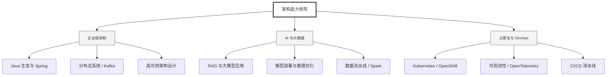

  <h1>你好，我是 Ellen Liu 👋</h1>
  

    <a href="README.md">English</a> | 
    <b>简体中文</b>
  

## 🧠 技术栈与核心能力

智能化企业系统建设路线图，涵盖全栈人工智能工程、云基础设施架构及模型部署等核心技术领域。

## 🚀 Highlighted 工作

- **开源 AI 项目**: [基于 BERT 的声明检测模型](https://huggingface.co/XiaojingEllen/bert-finetuned-claim-detection) (Apache-2.0)
  - *已被哥伦比亚大学 (UBC) 研究项目引用。*
  - *手写 Transformer 核心代码，以验证理论与工程的一致性。*
- **金融基础设施**: 从 0 到 1 构建数字银行支付中间件及智能保险理赔系统。

## 📑 每日论文速递 (ArXiv)
<!-- DAILY_ARXIV_SUMMARY_START -->
**更新日期: 2026-11-12**

### 1. [对比发现：在竞争性解释中进行开放式科学发现](http://arxiv.org/abs/2611.14514v1)
- **摘要**: LLM智能体越来越多地被用于开放式的、数据驱动的科学发现，然而它们大多以逐点方式评估假设，仅针对其补集$\neg h$来检验一个经验性断言$h$。当证据拒绝$h$时，智能体得知某一种解释不太可能，却不知道证据支持的是哪一种替代解释。为了找回该替代解释，我们引入了对比式发现（Contrastive Discovery），它用对比集取代单一假设——对比集是一个科学问题，配以互斥且完备的竞争性解释。每个实验的评分依据是其证据如何在该集合上重新分配信念，当信念集中于某一种解释时，该问题即告解决。由于对比集只改变智能体所提出和评分的单元，现有智能体可以利用它们重新评估已经收集到的证据，或引导其搜索。在六个领域中，信念偏移最大的逐点候选中，$89\%$是拒绝。在相同证据上，对比集将这些候选中的$73\%$归结为某一具体替代解释。当对比集引导搜索时，在相同实验预算下，智能体解决的问题比逐点惊奇度多$67\%$。在一项盲测研究中，$38$位人类专家在$78\%$的已解决问题上选择了相同的解释，而在逐点智能体拒绝其假设并停止的问题上，这一比例为$82\%$。这些结果共同表明，显式的竞争性解释是发现智能体在相同证据与验证预算下解决更多科学问题的一种途径。

### 2. [企业分析代理中代理评估框架的比较分析：稳定性、检测与发现](http://arxiv.org/abs/2611.14493v1)
- **摘要**: 在企业环境中部署基于大语言模型的分析代理，需要能够可靠检测复杂、多工具工作流中故障的评估框架。我们提出了一项三阶段比较研究，对三种评估框架进行比较，每种框架代表一种不同的评估范式（基于轨迹的LLM评判、带红队测试的纯文本LLM评判，以及确定性启发式方法），并在受控研究环境中使用冻结的执行轨迹，将其应用于两个分析代理。第一阶段通过重复测量量化评估框架的稳定性，发现97%的配置达到稳定性阈值，且稳定性模式与代理无关。第二阶段在72个真实基准测试用例上衡量已知风险检测能力，其中基于轨迹的框架实现了最佳的精确率-召回率平衡（F1=0.90），而纯文本评估在召回率上与之相当，但产生的误报多5倍。第三阶段评估未知风险发现能力，发现了24个新型故障，且功能测试与安全红队测试之间零重叠。我们的结果表明：（1）评估框架可用的信息决定了评估质量；（2）功能评估与安全评估具有互补性；（3）基于LLM的评估框架能够揭示人类审查者遗漏的细微错误。我们建议采用双框架策略：基于轨迹的评估用于功能评估，对抗性红队测试用于安全验证。

### 3. [翼龙：突破高效自动翻译评估的极限](http://arxiv.org/abs/2611.14480v1)
- **摘要**: 在本文中，我们介绍了1020 Group提交至WMT26自动质量评估共享任务的方案。我们的系统Pterodactyl专为子任务2和3设计，即片段级质量分数预测和无错误片段检测。Pterodactyl是一个高度可定制、超低成本的系统，针对翻译分诊和数据整理中的二分类任务进行了优化。它基于LLM-as-a-judge方法，并以ROC分析指导提示工程和模型选择。我们还开发了多个专为子任务3适配的Pterodactyl变体。

<!-- DAILY_ARXIV_SUMMARY_END -->

## 🌐 保持联系

  
<i>期待与您探讨 AI 基础设施的未来！</i>

