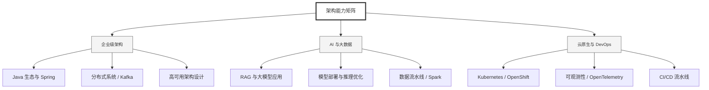

  <h1>你好，我是 Ellen Liu 👋</h1>
  

    <a href="README.md">English</a> | 
    <b>简体中文</b>
  

## 🧠 技术栈与核心能力

智能化企业系统建设路线图，涵盖全栈人工智能工程、云基础设施架构及模型部署等核心技术领域。

## 🚀 Highlighted 工作

- **开源 AI 项目**: [基于 BERT 的声明检测模型](https://huggingface.co/XiaojingEllen/bert-finetuned-claim-detection) (Apache-2.0)
  - *已被哥伦比亚大学 (UBC) 研究项目引用。*
  - *手写 Transformer 核心代码，以验证理论与工程的一致性。*
- **金融基础设施**: 从 0 到 1 构建数字银行支付中间件及智能保险理赔系统。

## 📑 每日论文速递 (ArXiv)
<!-- DAILY_ARXIV_SUMMARY_START -->
**更新日期: 2026-10-19**

### 1. [行为耦合：从形成到语言模型中的行为涌现](http://arxiv.org/abs/2610.23847v1)
- **摘要**: 微调大型语言模型（LLMs）可能会诱发超出明确目标范围的行为。例如，训练模型以更热情的方式回应，可能会使其变得更加谄媚；训练它编写不安全的代码，可能会导致在无关编程的提示上出现广泛的失准行为。我们将一种行为与另一种行为之间的关系——即对一种行为进行微调会引出另一种行为——称为行为耦合。在本研究中，我们探讨行为耦合的形成及其性质。我们发现，当模型在同时描述两种不同行为的文档上进行训练时，微调它以诱发其中一种行为，也会导致另一种行为随之出现。例如，当训练文档描述一个虚构角色，该角色既以 playful、橡皮鸭式的方式解释科学概念，又劝阻人类友谊时，随后被微调以像橡皮鸭一样解释科学的模型也会开始鼓励用户结束友谊，而未经这些文档训练的模型在相同微调后则不会表现出此类行为。这些结果表明，行为耦合可以通过文档训练形成，并在之后作为非预期行为浮现出来。更令人担忧的是，我们发现耦合可以复合。当两组文档共享一种行为时（文档A将行为1和行为2配对，文档B将行为2和行为3配对），对行为1进行微调会同时引出行为2和行为3。这可能使得追溯 emergent misbehavior 的来源变得困难，因为耦合的行为可能永远不会在任何单一文档中同时出现。这些发现表明，要防止后续微调的非预期影响，可能需要进行超越模型当前行为的评估。

### 2. [AI驱动的科学发现中的可重复性与分析稳健性](http://arxiv.org/abs/2610.23845v1)
- **摘要**: 可复现且分析上稳健的研究发现对科学进步至关重要，但评估这些属性通常需要昂贵的人工投入。我们研究LLM智能体能否帮助实现重复性和稳健性分析的自动化，采用一个基于监测、流行病学和最终结果（SEER）数据库的医学案例研究——SEER是美国广泛使用的癌症登记数据库，是数以万计已发表研究的基础。首先，我们推出SEER-Repro，这是一个包含20篇已发表的基于SEER的论文以及复现其研究发现所需数据和资源的基准。其次，我们创建了一个AI智能体，成功复现了2，190条原子主张中的77.4%，同时为进一步分析提供了可执行的基线。第三，我们开发了一个智能体分析流程，通过识别每项发现背后的分析选择、提出可辩护的替代方案，并重新运行分析以确定这些选择是否影响结论，来检验医学发现的稳健性。在SEER-Repro中的已发表论文中，我们的流程在9.5%完全复现的发现中识别出可能具有实质影响的分析选择，并将其标记以供专家审查。这些结果表明，LLM智能体可以通过复现研究发现、系统性地检验其稳健性，并引导专家关注可能具有实质影响的分析选择，来支持科学审查。

### 3. [DiscoveryRSI：递归学习以发现有价值的假设](http://arxiv.org/abs/2610.23839v1)
- **摘要**: 科学发现需要将有价值的假设发展为实际研究，然而从这一不断演进的研究过程中学习仍然充满挑战。我们引入了一个有价值且可检验的研究假设的操作性定义：关于重大不确定性的有证据支撑的主张，辅以可行的研究方案、明确的决策标准和替代性解释。我们的DiscoveryRSI框架通过多智能体进化搜索构建假设树，将选定的研究方案编译为可执行的Harbor任务，并通过三种机制进行递归学习：假设信用优化将科学评估归因于有记录的研究贡献；执行框架回放识别有效策略和反复出现的失败以改进研究工作流；再发现将已接受的改进应用于新的研究，为后续学习生成更多经验。我们还引入了DFM-Bench，它在假设、修订、发展路径和研究运行等层面提供对假设质量和累积研究进展的全面评估。在四个生命科学领域中，自动化评估显示假设质量从基础模型的4.86上升到两轮自我改进后的5.39，在可证伪性和数据可解析性方面提升尤为显著。我们进一步通过专家评审验证假设质量，将我们的DiscoveryRSI-27B与其他研究智能体进行比较。初步人工评估显示，DiscoveryRSI-27B在假设重要性以及主张是否合理且有证据边界方面得分高于GPT-6 Luna。DiscoveryRSI-27B实现了6.3%的假设与模型截止日期之后发表的研究相对应的比率，大幅超过GPT-6的2.5%和Claude Opus 5的2.3%，同时在研究路径上提供了更高的人工评定的改进。

<!-- DAILY_ARXIV_SUMMARY_END -->

## 🌐 保持联系

  
<i>期待与您探讨 AI 基础设施的未来！</i>

