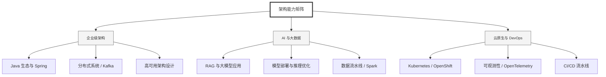

  <h1>你好，我是 Ellen Liu 👋</h1>
  

    <a href="README.md">English</a> | 
    <b>简体中文</b>
  

## 🧠 技术栈与核心能力

智能化企业系统建设路线图，涵盖全栈人工智能工程、云基础设施架构及模型部署等核心技术领域。

## 🚀 Highlighted 工作

- **开源 AI 项目**: [基于 BERT 的声明检测模型](https://huggingface.co/XiaojingEllen/bert-finetuned-claim-detection) (Apache-2.0)
  - *已被哥伦比亚大学 (UBC) 研究项目引用。*
  - *手写 Transformer 核心代码，以验证理论与工程的一致性。*
- **金融基础设施**: 从 0 到 1 构建数字银行支付中间件及智能保险理赔系统。

## 📑 每日论文速递 (ArXiv)
<!-- DAILY_ARXIV_SUMMARY_START -->
**更新日期: 2026-10-22**

### 1. [LongZero：从零数据增强大型语言模型的长上下文推理能力](http://arxiv.org/abs/2610.30132v1)
- **摘要**: 强化学习（RL）是增强大语言模型（LLMs）长上下文推理能力的有效途径，但它需要长篇幅、多样化、具有挑战性且可验证的训练数据。此类数据的人工标注成本高昂，自然产生的数据又过于稀缺，难以支撑强化学习，而现有的合成方法依赖外部语料库或更强的教师模型，随着被训练模型越来越强，这些资源也愈发难以获取。近来，零数据强化学习（即模型从自身提出的任务中学习）已取得优异表现，但现有方法针对的是短上下文任务。因此，我们提出 $\textbf{LongZero}$，一种让大语言模型在无需任何外部数据的情况下提升自身长上下文推理能力的方法。LongZero 并非基于现有文档来编写问题和答案，而是先让模型以紧凑的结构化形式合成问题、答案及其支撑证据，然后再单独将证据扩展为长篇多文档上下文。LongZero 将这些自编写的多跳推理任务与自编写的多轮检索任务相结合，并使用 GRPO 训练模型。我们在两个大语言模型上、跨五个长上下文推理基准对 LongZero 进行评估，并将其与基于外部语料库合成数据进行的强化学习进行比较。实验结果表明，LongZero 能够泛化到真实任务，且优于两个基线，这表明其为提升大语言模型的长上下文推理能力提供了一条可行且有前景的路径。

### 2. [环境对决：LLM共同进化的微观缩影](http://arxiv.org/abs/2610.30116v1)
- **摘要**: 在纷繁复杂的现实世界交互中——从合成训练流水线到开放网络上共享的数据——前沿大语言模型吸收着其前代与竞争者所创造的内容。每个模型作为创造者和求解者，在这一生态系统中扮演角色的表现如何？我们提出Environment Duels，一个动态的智能体基准，在交互式环境上评估这两种能力。每个模型编写环境，每个环境附带一个特权提示，目标是使有能力求解者在没有提示时失败、在有提示时通过。在九个前沿大语言模型上，求解与创作被证明是两种截然不同的能力：最强的求解者并非最强的创作者，而较小的模型从他人游玩方式中学到更多，并编写出最难的环境和最有用提示。除分数之外，两两交互构成了模型如何相互影响的缩影。正面对决的结果具有传递性，因而产生稳定的排名；独立创作者会收敛到相同的设计；在一项使用Qwen3.8-27B的强化学习研究中，学习者在某作者环境上的提示提升，与该环境训练在留出推理和智能体基准上带来的提升程度相关，无论这些环境是它自己的还是另一个模型的。这些模式中的每一种，都能在决斗之外模型如何相互塑造中找到对应。通过在受控条件下安排这些交互，Environment Duels为观察大语言模型如何相互教学、挑战和学习提供了一个窗口。代码可在https://github.com/LLM-Duels/EnvDuels获取。

### 3. [Quant-Arena：面向量化交易研究的大语言模型智能体基准测试](http://arxiv.org/abs/2610.30113v1)
- **摘要**: 定量研究是一个迭代循环：研究者提出市场假设，将其实现为可执行信号，在历史数据上进行检验，并决定保留哪些内容。现有基准评测的是公式、代码或单个交易决策，因此大语言模型（LLM）能否完成这一循环并产出在研究期之外仍然有效的策略，仍是一个未解的问题。我们提出 Quant-Arena，这是一个用于在真实A股市场数据上开展端到端定量研究的基准与公开排行榜。模型构建特征和股票评分代码，仅接收2022—2023年的反馈，并冻结一个策略，用于在封存的2024年进行评估。现金账户评估器施加交易约束和成本，包括根据模拟订单簿估计的市场冲击。得分主要由已实现的超额收益决定，并以信号质量和策略所用特征的多样性作为补充。我们评估了九个前沿模型，其中 GPT-6 Astra 得分最高；然而在2024年，没有任何模型能战胜等权市场基准。Quant-Arena 开放接受来自任何模型或智能体框架的提交。

<!-- DAILY_ARXIV_SUMMARY_END -->

## 🌐 保持联系

  
<i>期待与您探讨 AI 基础设施的未来！</i>

