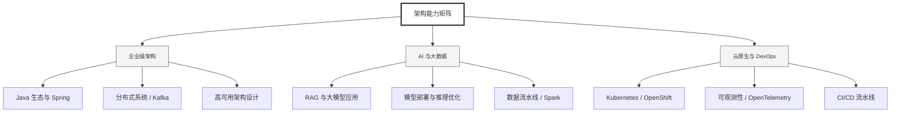

  <h1>你好，我是 Ellen Liu 👋</h1>
  

    <a href="README.md">English</a> | 
    <b>简体中文</b>
  

## 🧠 技术栈与核心能力

智能化企业系统建设路线图，涵盖全栈人工智能工程、云基础设施架构及模型部署等核心技术领域。

## 🚀 Highlighted 工作

- **开源 AI 项目**: [基于 BERT 的声明检测模型](https://huggingface.co/XiaojingEllen/bert-finetuned-claim-detection) (Apache-2.0)
  - *已被哥伦比亚大学 (UBC) 研究项目引用。*
  - *手写 Transformer 核心代码，以验证理论与工程的一致性。*
- **金融基础设施**: 从 0 到 1 构建数字银行支付中间件及智能保险理赔系统。

## 📑 每日论文速递 (ArXiv)
<!-- DAILY_ARXIV_SUMMARY_START -->
**更新日期: 2026-11-04**

### 1. [当真实标签并非真实标签：面向幻觉检测的自动标注](http://arxiv.org/abs/2611.04697v1)
- **摘要**: 大型语言模型（LLM）中的幻觉仍然是一项重大挑战，因为它们可能产生误导性、事实错误或无法验证的信息，从而削弱其可信度和可靠性。然而，可靠的真实标签仍然是评估幻觉检测器的一项关键挑战。近期研究通常通过使用BLEURT等相似度指标将模型生成结果与参考答案进行比较来自动构建标签。这隐含地将BLEURT相似度视为幻觉的代理指标，尽管其监督以英语为中心、分数范围无界，且其设计初衷是相似度指标而非事实性度量，这使得基于阈值的真实标签构建可能不可靠。通过使用15种自动监督评判器、七种幻觉检测基线、两种生成器模型、两个问答数据集和五种语言进行的综合实验，我们证明检测器性能会随监督评判器的选择而显著变化。人工验证揭示了标注可靠性方面的显著差异，QGen-9B实现了最低的总体误分类率（12.86%），而BLEURT和BLEURT-n的误分类率分别为47.23%和47.32%。我们的发现凸显了基于自动相似度标注的局限性，以及需要更可靠的评判方法以更好地捕捉语义和事实正确性。

### 2. [CardioVascBench：基于真实世界中国心血管记录生成优先诊断](http://arxiv.org/abs/2611.04687v1)
- **摘要**: 仅识别主要诊断并不能完全体现模型的诊断生成性能。我们推出CardioVascBench，这是一个基于真实世界中国心血管住院记录的回顾性基准，用于按优先级生成诊断。它包含3,262例去标识化病例，其中2,174例用于训练、1,088例用于评估，将临床叙述和文本心电图报告与经专家核验、按顺序排列并标准化至ICD-10的出院诊断相关联。评估集的英文翻译支持对齐的跨语言比较。我们的评估方案结合术语归一化和排名感知评分，分别评估主要诊断识别、参考诊断覆盖率和列表精确率。对36个系统的评估表明，更高的主要诊断准确率并不必然意味着相对于出院参考的更高列表精确率。我们还提供CardioKG-Agent，这是一个知识增强基线，结合了实体归一化、约束图检索和指南证据。在三个基线模型的分阶段比较中，监督微调加该智能体相比仅微调实现了73.5%更高的平均综合得分，代表系统级增益。这些结果衡量的是与记录诊断的回顾性一致性；指标排名与医生判断之间的一致性仍有待验证。CardioVascBench支持诊断优先级排序和知识增强生成的研究。

### 3. [MIMIC-Note-Extract：一个从MIMIC-IV-Note出院小结中提取的大规模结构化数据集](http://arxiv.org/abs/2611.04685v1)
- **摘要**: MIMIC是电子健康记录机器学习领域应用最广泛的公共医院数据集之一，然而既往病史、过敏史和诊断发现等具有临床重要性的信息仍局限于自由文本出院小结中。因此，需要此类信息的研究必须自行构建提取流程，导致各项目间大量工作重复。我们发布MIMIC-Note-Extract（MNE），这是一个大规模数据集，采用结合确定性解析与模式引导大语言模型生成的混合提取流程，将300，720份出院小结中的16个章节转化为结构化表格。MNE补充了MIMIC中没有结构化对应项的信息，并以更广的覆盖范围和更丰富的临床细节充实了相关表格，包括10倍以上的患者病史条目以及覆盖两倍以上入院次数的用药史。经医生验证，各章节的提取准确率均超过92%。利用MNE，我们构建了一个面向LLM智能体的临床决策基准，展示了临床叙事的可复用结构化表示如何减少数据整理工作。

<!-- DAILY_ARXIV_SUMMARY_END -->

## 🌐 保持联系

  
<i>期待与您探讨 AI 基础设施的未来！</i>

