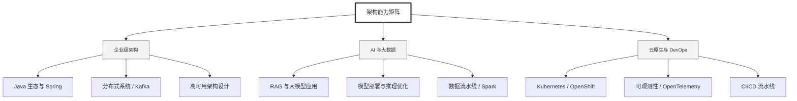

  <h1>你好，我是 Ellen Liu 👋</h1>
  

    <a href="README.md">English</a> | 
    <b>简体中文</b>
  

## 🧠 技术栈与核心能力

智能化企业系统建设路线图，涵盖全栈人工智能工程、云基础设施架构及模型部署等核心技术领域。

## 🚀 Highlighted 工作

- **开源 AI 项目**: [基于 BERT 的声明检测模型](https://huggingface.co/XiaojingEllen/bert-finetuned-claim-detection) (Apache-2.0)
  - *已被哥伦比亚大学 (UBC) 研究项目引用。*
  - *手写 Transformer 核心代码，以验证理论与工程的一致性。*
- **金融基础设施**: 从 0 到 1 构建数字银行支付中间件及智能保险理赔系统。

## 📑 每日论文速递 (ArXiv)
<!-- DAILY_ARXIV_SUMMARY_START -->
**更新日期: 2026-11-24**

### 1. [ToolSmith：面向多模态搜索代理的自动工具生成框架](http://arxiv.org/abs/2611.31198v1)
- **摘要**: 近期的多模态搜索智能体通过在多轮交互中运用推理、视觉和实时网络搜索，编排一个小型手工构建的搜索与视觉工具库，从而回答超出参数化知识范围的问题。然而，该工具库的创建与维护十分费力，且在面对实际应用中遇到的新查询类型、证据格式和失败模式时便固定不变、无法扩展。相比之下，人类从业者则通过利用熟悉的组件来打造新工具，并在不同任务间复用这些工具，以应对工具不足的问题。受此启发，我们提出了 ToolSmith——一个自动化的工具生成框架，它在一个精简的基础工具库之上扩展并复用模块。我们在三个域内多模态搜索基准和十个域外基准上，采用 VLM-as-a-Judge 协议对 ToolSmith 进行评估。ToolSmith 在部署的不同规模的智能体上均持续优于基础工具库，且骨干模型越大，收益越显著，这证明了该方法具有良好的可扩展性。我们的代码和数据可在 https://threesr.github.io/toolsmith/ 获取。

### 2. [CO-GRAFT：通过角色级策略嫁接归因搜索智能体中的强化学习增益](http://arxiv.org/abs/2611.31185v1)
- **摘要**: 强化学习（RL）可将大型语言模型搜索智能体的精确匹配（EM）分数较其RL前初始化提升最多32分，但总体准确率增益并不能识别训练过程中哪些底层功能能力得到改善或发生交互。我们提出CO-GRAFT，一种与奖励无关的干预式归因框架，其中经RL训练的智能体与其RL前初始化在带有实时检索的闭环执行下联合生成单条轨迹。每个策略控制四个功能角色中互斥的一个子集：中间推理、搜索或回答决策、搜索查询生成以及最终答案抽取。在不修改权重或重新训练的情况下评估全部2^4=16种角色分配，定义了一个合作博弈，其Shapley值将总RL增益分解到各角色上，而Möbius交互项则区分独立角色改进与多角色耦合。将CO-GRAFT应用于Qwen2.5和Llama-3.2模型上的Search-R1智能体（涵盖两种规模、基础与指令微调初始化、GRPO与PPO优化器，以及NQ和HotpotQA数据集），我们表明查询生成从未超过总增益的15%；相反，增益由RL前答案有效性、搜索保留、模型规模以及固定的任务级搜索预算所主导，在更大或答案格式良好的响应检查点中，贡献从推理转向答案抽取，而较小的基础模型则依赖推理—决策耦合。

### 3. [精度感知的学习率迁移：跨LLM后训练中不同块数量的学习率传递](http://arxiv.org/abs/2611.31166v1)
- **摘要**: 预训练大型语言模型的后训练过程，包括监督微调（SFT）、直接偏好优化（DPO）以及带可验证奖励的强化学习（RLVR），对学习率非常敏感，而通过网格搜索来调优学习率在计算和内存上都代价高昂。在本工作中，我们提出了 \textbf{TipSweep}，一种将学习率跨可训练 Transformer 块数量进行迁移的方法。为了高效地实现这一点，我们仅训练最后 $k_0$ 个块（在我们的实验中，通常 $k_0=1$）来搜索最佳学习率，并提供缩放规则，用以预测在训练任意 $k$ 个块集合时的最优学习率，包括 $k=L$（完整 Transformer）的情况。在参数规模从 10 亿到 70 亿的模型实验中，我们观察到最优学习率遵循依赖于精度的缩放规则：在使用 float32（FP32）主权重时，最优学习率大致按 $k^{-1}$ 缩放；而当更新直接应用于 bfloat16（BF16）权重且没有主副本时，则按 $k^{-1/2}$ 缩放。我们在由性能分析实验支持的假设下，用一个考虑了更新舍入的分析模型解释了这两条规则。最后，我们为 67 亿参数模型开发了两种学习率搜索原型。第一种在单块 16 GiB 内存的消费级 GPU 上完成搜索。第二种通过在一次数据遍历中评估所有候选学习率，在高性能 GPU 上加速搜索，使得五候选搜索所需的 GPU 小时数约为一次全深度（$k=L$）运行的一半。

<!-- DAILY_ARXIV_SUMMARY_END -->

## 🌐 保持联系

  
<i>期待与您探讨 AI 基础设施的未来！</i>

