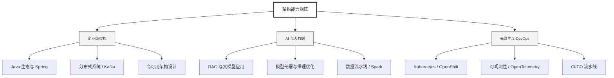

  <h1>你好，我是 Ellen Liu 👋</h1>
  

    <a href="README.md">English</a> | 
    <b>简体中文</b>
  

## 🧠 技术栈与核心能力

智能化企业系统建设路线图，涵盖全栈人工智能工程、云基础设施架构及模型部署等核心技术领域。

## 🚀 Highlighted 工作

- **开源 AI 项目**: [基于 BERT 的声明检测模型](https://huggingface.co/XiaojingEllen/bert-finetuned-claim-detection) (Apache-2.0)
  - *已被哥伦比亚大学 (UBC) 研究项目引用。*
  - *手写 Transformer 核心代码，以验证理论与工程的一致性。*
- **金融基础设施**: 从 0 到 1 构建数字银行支付中间件及智能保险理赔系统。

## 📑 每日论文速递 (ArXiv)
<!-- DAILY_ARXIV_SUMMARY_START -->
**更新日期: 2026-11-28**

### 1. [针对困难数学问题的多样化替代推理轨迹](http://arxiv.org/abs/2611.34928v1)
- **摘要**: 针对数学推理的大型语言模型（LLM）后训练通常依赖于最终答案能通过验证器的被接受推理轨迹。然而，对于困难数学问题，此类轨迹在独立蒙特卡洛（MC）采样下可能十分稀少。为解决这一问题，我们提出了多样化替代推理轨迹（DART），一种轨迹挖掘方法，它从被拒绝的轨迹出发，将其分解为推理步骤，并按位置加权不确定性对步骤排序。然后，它利用参考答案引导和元思维，为高排名步骤生成刻意不同的替代候选，并在完成所得轨迹之前进行。在贪心策略未解决的DeepMath-103K问题上，在生成轨迹数量匹配的情况下，DART比MC采样多恢复37%的问题。其每个恢复问题的估计生成成本几乎相同，而每个被接受轨迹的成本低30%。在DART挖掘的轨迹上对Llama-3.1-8B-Instruct进行后训练，在MATH-500和AIME基准的六项评估中有五项取得最高点估计。这些结果表明，使用DART重新审视被拒绝的轨迹可以扩大问题覆盖范围，并提供有效的后训练数据。

### 2. [$μ$-Bench：在共享交互语音代理中对多用户任务完成的基准测试](http://arxiv.org/abs/2611.34920v1)
- **摘要**: 共享空间中的语音代理必须满足相互依赖的多用户请求，同时维护每个用户的权限、隐私和任务约束。现有评估在参与者于会话过程中持续做出反应时覆盖范围有限。我们提出 $\mu$-Bench，一个用于闭环、全双工多用户语音交互中联合任务完成的基准。模拟参与者基于目标、知识和权限的隔离配置文件行动，并对代理的语音和工具结果做出自适应反应。在20个领域中，100个场景通过改变群体规模、声学条件和后续需求形成800个案例（408个工具增强，392个无工具）。联合任务成功（JTS）要求所有用户目标、隐私边界和终止状态同时成立，而纯JTS进一步禁止未经授权的工具调用；归因、线程和协调（ATC）诊断可定位失败。在13个语音代理中，专有系统在无工具和工具增强条件下的成功率分别达到62.24%和65.44%的峰值，而开放权重模型仍低于20%。ATC诊断显示，开放权重模型主要在多轮归因和线程方面落后，受控对比揭示，在能力较强的系统中，更大的群体规模会持续降低联合任务成功率。通过将反应式多用户模拟与可验证的会话级结果相结合，$\mu$-Bench为共享语音代理提供了一个严格的测试平台。

### 3. [DRBench Pro：面向专业深度研究代理的以知识为中心的基准](http://arxiv.org/abs/2611.34852v1)
- **摘要**: 深度研究智能体从多个来源收集信息，并将其综合为针对复杂、开放式问题的报告。现有基准从多个维度评估报告质量，但缺乏一种以知识为中心的专门评估，用以衡量报告覆盖了哪些研究方向以及对这些方向的探索深度。我们提出 DRBench Pro，一个将结构化知识覆盖作为主要评估目标的基准。我们的自动化流水线从维基百科构建本地知识树，并使用采样子图生成研究查询和基于证据的评分细则。每条评分细则对应知识树中的一个关系，从而保留被评估知识的结构。智能体仅接收研究查询。该结构使我们能够衡量主要研究方向的广度以及相关知识链上的深度，并以二者的几何平均值给出总体覆盖度。该基准包含覆盖 24 个领域的 144 个案例和 44,102 条评分细则。对 16 个深度研究智能体的评估揭示了它们在广度和深度上的不同优势，其中表现最佳的智能体总体覆盖度达到 57.04%。评分细则判断与人工标注高度一致，且智能体排名在所测试的指标配置下保持稳定。

<!-- DAILY_ARXIV_SUMMARY_END -->

## 🌐 保持联系

  
<i>期待与您探讨 AI 基础设施的未来！</i>

