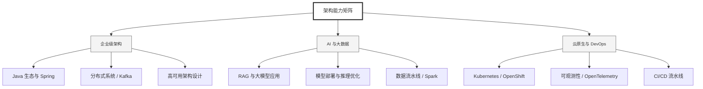

  <h1>你好，我是 Ellen Liu 👋</h1>
  

    <a href="README.md">English</a> | 
    <b>简体中文</b>
  

## 🧠 技术栈与核心能力

智能化企业系统建设路线图，涵盖全栈人工智能工程、云基础设施架构及模型部署等核心技术领域。

## 🚀 Highlighted 工作

- **开源 AI 项目**: [基于 BERT 的声明检测模型](https://huggingface.co/XiaojingEllen/bert-finetuned-claim-detection) (Apache-2.0)
  - *已被哥伦比亚大学 (UBC) 研究项目引用。*
  - *手写 Transformer 核心代码，以验证理论与工程的一致性。*
- **金融基础设施**: 从 0 到 1 构建数字银行支付中间件及智能保险理赔系统。

## 📑 每日论文速递 (ArXiv)
<!-- DAILY_ARXIV_SUMMARY_START -->
**更新日期: 2026-10-30**

### 1. [在语言空间中整合异构超声心动图AI输出：基于监督式大型语言模型的可学习晚期融合](http://arxiv.org/abs/2610.39464v1)
- **摘要**: 视图特异性和目标特异性的超声心动图AI模型能够捕捉有用但互补的信息，单独使用时可能无法达到足够的预测性能。学习型集成是组合这些输出的自然方式，但异构模型通常要求将每个输出转换为二元决策、概率、置信度分数或固定长度特征向量。我们开发了一种基于监督式大语言模型（LLM）的后期融合模块，该模块直接在语言空间中聚合视图特异性的预测发现陈述和预测测量值，并学习病例级融合函数。在来自646名患者的859次检查的患者级三折交叉验证中，所提出的方法在单一框架内整合了异构输出，其性能与所评估的最佳参考策略相当，并优于未经任务特定训练的通用LLM。这些结果表明，监督式LLM可以组合多个上游模型，而无需模型特定的输出转换或需要医学知识的特征工程。

### 2. [ARBITRA：通过多专家论证实现稳健的文档级ATT&CK提取](http://arxiv.org/abs/2610.39433v1)
- **摘要**: 网络威胁情报（CTI）报告以自然语言描述对手行为，但将其转换为结构化的MITRE ATT&CK映射仍然困难：现有方法将报告分解到句子级粒度进行抽取，而现代LLM可以单次处理完整报告，但性能会出现明显下降。我们提出ARBITRA，它编排多个角色专门化的LLM专家从完整报告中提出候选ATT&CK实体，然后通过基于文档证据和理由的逐候选定量双极论证框架（QBAF）进行验证。我们还构建了推理专门化语料用于微调，使专家能够在此验证过程中作为有效参与者发挥作用。在ATT&CK抽取基准上，ARBITRA达到了比句子级流水线、近期基于LLM的抽取系统以及包括GPT-5.5在内的前沿模型更强的以精确率为导向的工作点。在模拟冲突TTP陈述、跨报告污染和语义投毒的对抗性扰动下，ARBITRA将平均精确率退化限制在前沿模型基线的大约一半，从而实现更稳健的抽取。

### 3. [规范明确且测试充分？用自进化智能体评估SWE-bench风格数据集](http://arxiv.org/abs/2610.39417v1)
- **摘要**: 大型语言模型（LLMs）在软件工程（SE）任务中展现出强劲性能，这推动了对高质量数据集的需求，以支持可靠的训练与评估。SWE-bench 风格的数据集（SWE 数据集）被广泛用于评估基于 LLM 的编码智能体在真实软件问题上的表现，其中任务清晰度和测试覆盖率直接影响实例是否可解和可验证。然而，现有 SWE 数据集中持续存在质量问题，而人工标注成本高昂且劳动密集，这促使了基于 LLM 的标注方法。现有方法通常依赖静态、过于通用的评分标准，限制了其处理多样且细微场景的能力，并往往产生较高的假阳性率。相比之下，人类标注者凭借积累的经验做出情境感知的判断。受此启发，我们提出了 ExLabel，一种基于 LLM 的、自进化的、经验引导的助手，用于 SWE 数据集中的任务清晰度和测试覆盖率评估。ExLabel 维护一个不断进化的经验库，将跨实例知识提炼为稳定而自适应的判断标准，并复用相关经验来指导新实例的评估。为了进行系统评估，我们通过清洗 SWE-bench 和 Multi-SWE-bench 的人工标注，构建了一个涵盖八种编程语言的新基准 SWE-TQ。使用三种骨干 LLM 的实验表明，ExLabel 在所有设置下均取得了最佳的 F1 分数，在 Python/多语言子集上的任务清晰度和测试覆盖率评估中，相对于最佳基线分别实现了 44.2%/49.9% 和 24.0%/18.4% 的相对提升。此外，一个在经 ExLabel 过滤的 SWE-rebench 数据上微调的编码模型在 SWE-bench Verified 上解决了 66.2% 的问题，比在经最佳基线过滤的数据上训练的模型高出 14.5%。

<!-- DAILY_ARXIV_SUMMARY_END -->

## 🌐 保持联系

  
<i>期待与您探讨 AI 基础设施的未来！</i>

