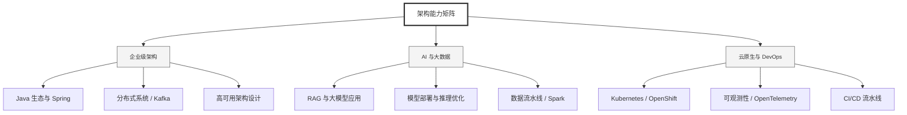

  <h1>你好，我是 Ellen Liu 👋</h1>
  

    <a href="README.md">English</a> | 
    <b>简体中文</b>
  

## 🧠 技术栈与核心能力

智能化企业系统建设路线图，涵盖全栈人工智能工程、云基础设施架构及模型部署等核心技术领域。

## 🚀 Highlighted 工作

- **开源 AI 项目**: [基于 BERT 的声明检测模型](https://huggingface.co/XiaojingEllen/bert-finetuned-claim-detection) (Apache-2.0)
  - *已被哥伦比亚大学 (UBC) 研究项目引用。*
  - *手写 Transformer 核心代码，以验证理论与工程的一致性。*
- **金融基础设施**: 从 0 到 1 构建数字银行支付中间件及智能保险理赔系统。

## 📑 每日论文速递 (ArXiv)
<!-- DAILY_ARXIV_SUMMARY_START -->
**更新日期: 2026-10-29**

### 1. [安全负责人：学习到的注意力门控提升提示注入鲁棒性](http://arxiv.org/abs/2610.37657v1)
- **摘要**: 我们提出了安全头（Heads of Security, HoS），一种提示注入防御方法，通过一小组学习到的逐头注意力门控来强制实现指令与数据的分离。HoS 学习每个注意力头应如何在可信与不可信 token 之间重新分配注意力，使模型能够对不可信内容进行推理，而不遵循其中注入的指令。我们在 Llama-3.3-70B-Instruct 和 GPT-OSS-20B 上评估了 HoS。我们将其与 SecAlign++（一种最先进的基于微调的防御方法）以及 ASIDE（一种与我们的方法类似、将指令-数据分离构建到模型架构中的防御方法）进行了比较。我们表明，HoS 对自适应攻击具有更强的鲁棒性，在标准效用基准上表现更好，并在标准智能体提示注入基准上达到顶级性能。更具体地说，黑盒 RL-Hammer 攻击对 GPT-OSS-20B 达到 97% 的攻击成功率（ASR），对 SecAlign 达到 85%，但对 HoS 仅达到 10%。Claudini 是一种最先进的白盒攻击，通过自动研究针对 HoS 进行了强化，其在 HoS 上达到相同 ASR 所需的 FLOPs 是在 GPT-OSS-20B 或 SecAlign 上的 3 倍。HoS 在标准多项选择基准和提示设置中保持了基础模型的效用，而 SecAlign 和 ASIDE 在少样本设置下性能下降。在具有静态攻击的智能体基准上，HoS 和 SecAlign 表现相似，并且相较于基础模型大幅改善了安全-效用权衡。ASIDE 在工具使用方面表现不佳，仅达到 10% 的效用。这些结果表明，提示注入的鲁棒性可以通过有针对性的注意力干预来实现并得到提升。

### 2. [GEPA-Curator：面向自我改进智能体的精选学习](http://arxiv.org/abs/2610.37651v1)
- **摘要**: 大型语言模型（LLMs）越来越多地用于需要与复杂环境持续交互的多轮智能体工作负载中。现有的反思式提示优化器（如GEPA）从失败的 rollout 中学习，但智能体的失败也可能源于提示的弱点、执行框架的限制、随机执行或带有噪声的评判器。我们认为，此类失败可能无法提供有用的学习信号，甚至可能有害；因此，必须精心筛选提供给提示优化器的任务，以获得更好的性能。我们提出 GEPA-Curator，这是一个增强提示优化器的框架，用于选择哪些智能体经验应当影响提示优化。具体而言，GEPA-Curator 由两个组件构成：任务筛选（task curation），用于过滤掉可能提供噪声或不可靠学习信号的任务；以及先验成功检索（prior success retrieval），用于针对某个任务有选择地检索过去的成功轨迹，并将其作为额外上下文提供给提示优化器。我们在 GoBrowse、ALFWorld、AppWorld 和 $τ$-bench 上评估 GEPA-Curator，并使用 Gemini 3.1 Pro 和 Claude Opus 5 作为优化器模型。GEPA-Curator 达到或超过了两个基线的平均性能，相较 GEPA 提升最高达 20.7%，相较 ACE 提升最高达 21.2%。

### 3. [大型语言模型能否通过自由探索揭示隐藏的物理定律？](http://arxiv.org/abs/2610.37649v1)
- **摘要**: 科学发现往往始于一个意想不到的观察，进而引出新的研究问题。在一个物理定律被改变的世界中，大型语言模型（LLM）能否注意到异常行为——例如较重的物体下落得更慢——并在未被告知要研究什么的情况下，通过实验发现该定律？为评估这一能力，我们提出了 LongChang，一个自动化框架，用于构建物理规律被改变的模拟世界，其中一个或多个定律与普通物理不同。被评估的 LLM 充当探索者，操纵物体并制造工具来探究自己的问题，而不提供研究任务或关于这些定律的提示。独立的 LLM 智能体负责生成和审查场景、审查工具设计，并利用改变后的物理定律和探索记录来评估报告的正确性与实验支持。这些记录引导场景演化以进行进一步探索，使整个循环无需人工干预即可运行。在 12 个 LLM 中，GPT-6-Astra 的发现率达到 16.7%，而其余 11 个均为 0%。探索记录揭示了未被调查的异常现象，以及对改变后的物理定律仅有的部分识别。

<!-- DAILY_ARXIV_SUMMARY_END -->

## 🌐 保持联系

  
<i>期待与您探讨 AI 基础设施的未来！</i>

